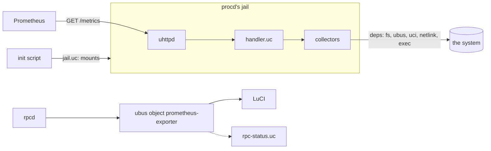

# About the Architecture

The exporter is not a daemon. It is a handler that uhttpd runs, a library of modules, a ubus object that rpcd serves, and an init script that ties them to procd. This page is about how those pieces fit, and why they are cut where they are.

---

## The pieces

- **uhttpd and the handler.** `/usr/libexec/prometheus-exporter/handler.uc` is a uhttpd-mod-ucode handler for `/metrics`. uhttpd is the server every OpenWrt image has; it does TLS, keep-alive and the socket work, and the exporter never listens on anything itself.
- **The library.** `/usr/share/ucode/prometheus_exporter/` holds the modules the handler, the command line, `check` and the ubus object share: the loader, the configuration, the scrape, the exposition format, the jail's rules.
- **The collectors.** One module each, in `collectors/`, installed by the base package or a package of its own.
- **The ubus object.** rpcd serves `prometheus-exporter` from a ucode plugin. It is how LuCI, or a script, asks the exporter what it would do: which collectors are installed, whether a value is valid, how each collector does.
- **The init script.** It checks the configuration, works out the jail from what the collectors declare, and hands procd the uhttpd instance.

## A process per request

uhttpd-mod-ucode runs the handler once, when uhttpd starts, and then answers each request in a process forked from that one. Everything the handler did at load time is there in every request, already done: the collectors are compiled and validated once, the configuration's `compress` and basic auth are read once. Nothing a request does is there for the next: its memory goes with its process.

That shapes two choices.

The first is that loading is the place for anything costly that does not change between scrapes, and that a change of what was loaded needs a restart, not a reload. Installing a collector package reloads the service; the init script has procd watch every collector module and config the jail mounts, and procd restarts uhttpd when one changed.

The second is that what must outlast a request has to go to disk. Two things do. Basic auth's cache: checking a password against its hash costs a scrape a large share of its time on a slow CPU, and a cache in memory would be gone by the next request. And the ledger: how long each collector takes, and its circuit breaker, which order the next scrape and say what its deadline has time for (see [About deadlines and circuit breakers](deadlines-and-breakers.md)). So each uhttpd instance has a small state directory on tmpfs, the one path its jail mounts read-write, and its files are named after the instance. The handler names its instance when uhttpd loads it, by the pid and start time of that process, which no later process can share; and it removes every other instance's files then. A restart starts without state, which is what a changed password or a changed collector should mean anyway, and how a quarantined collector is tried again at once.

Requests run at once, so the state is written under a lock: an exclusive `flock()` of the instance's lock file, which the kernel lets go of however a request ends. Each write is a whole new file renamed over the old, so a read, which takes no lock, never sees half of one; and a scrape records itself by reading the ledger again under the lock and adding to it, so scrapes that ran at once each count.

## A process of its own {#a-process-of-its-own}

A scrape cannot trust its collectors to return. One may loop forever, wait on a FIFO that nothing writes to, allocate until the memory runs out, or call `exit()`. Within one process there is no stopping that: ucode's VM runs a signal handler at its next instruction, which would do, but uhttpd-mod-ucode's VM handles no signals at all (a handler is never called, and the signal's default action ends the request), and a native call blocked in a system call would not reach the next instruction anyway.

So each scrape forks a child, with ucode's `uloop.task`, from the process that already has the collectors loaded: a fork costs no compiling. The child runs the collectors one after the other, asking the scrape for each, and the scrape holds a timer on the one that runs. When the collector's budget ends, or the scrape's deadline comes first, the scrape kills the child, records the collector as stopped, and forks another for the rest. A child that dies under a collector, out of memory or of a crash, costs that collector alone. Each process of the service has a data limit, so a collector that allocates without end aborts its own child, not the router.

A collector's run crosses back to the scrape through a file the scrape made before it forked the child, removed as soon as it is made, which they share: its samples as the text the reply will hold, never re-encoded. The pipe between them carries only where each run is, in messages short enough that the scrape reads them whole: ucode's uloop reads the pipe without blocking, and loses a message that is half there.

The scrape keeps a progress file beside the ledger: a line before each collector, with the child it runs in. If the scrape process itself dies, killed from outside, the next scrape finds the file, names the collector that was running, quarantines it, and kills the child it may have left looping.

Loading is guarded the same way. uhttpd loads the collectors once, in the process every scrape is forked from: a module whose top level never returns would keep it from ever serving. So each module is first loaded in a child, five seconds at most, and only those that loaded there are loaded for real. rpcd, which must never hang either (it serves the whole of LuCI), asks a helper process to load a module it has not seen before, once per version of the module.

What this costs a scrape is a fork, a round trip per collector and the file; see [Performance on small routers](performance.md#a-process-per-collector).

## Only one module touches the system

`prometheus_exporter.deps` and its modules, one per capability (`deps/ubus.uc`, `deps/exec.uc`, ...), are the only ones that import `fs`, `ubus`, `uci`, `rtnl`, `nl80211` and `socket`. A collector does not import them: it declares in `meta.needs` the capabilities it wants, and `collect` receives exactly those, in its `deps` argument.

This is dependency injection, and it pays three times.

- **Tests.** A test builds `deps` from utest's mocks, fed with what real devices answered, and runs the collector as a scrape would. No collector needs a router to be tested.
- **The jail.** What a collector may reach is written down, so the service can build the jail from it rather than from a list someone keeps by hand.
- **The narrowing.** `deps` is not the module, but a channel over it that hands out less: `fs` without its writing functions, `uci` as handles on the configs a collector named and nothing else, read-only and of the committed configuration only, `exec` only for the programs listed and with a deadline. A collector that tries more has no way to.

Taking every native function by name in one module also makes `make lint` meaningful: loading that module on OpenWrt 25.12's ucode fails if the release lacks a function the exporter uses, at build time and not in a scrape.

## The loader

The loader takes every module of the collectors' directory, refuses one that is not in strict mode (a variable never declared is then an error, not a global every later collector sees), loads each in a child process first, validates its `meta` and `collect`, and leaves out one that does not load in time or is not valid, logging why. A broken subpackage costs its own collector and nothing else. The same loader runs in the handler, the command line, `check`, the jail's script and the ubus object, so all of them agree on what is installed.

## Why the ubus object lives in rpcd

The handler only runs inside a request, and only in the jail. Something has to answer questions about the exporter when nobody scrapes, outside the jail, and to LuCI: rpcd, which every image runs, and which already serves LuCI's other objects. Its plugin reads with the exporter's own modules, so it sees what the exporter sees.

One method, `status`, runs a scrape. Collectors call ubus objects, and some of those objects are rpcd's own (`wireguard`, `luci`): rpcd cannot answer them while it waits for the scrape. So `status` runs the scrape in a process of its own and replies when that process is done, and rpcd answers other calls meanwhile. That process runs the collectors in the service's own jail, with ujail, as `check` and the command line's scrape do, so all of them find what Prometheus gets; and rpcd kills it, with all it started, if it ever outlives a scrape's time.

## See also

- [About the security model](security.md): what the jail is for.
- [Collector interface](../reference/collector-interface.md): `meta`, `deps` and `out` in detail.
- [The jail](../reference/jail.md): the mounts and the state.
