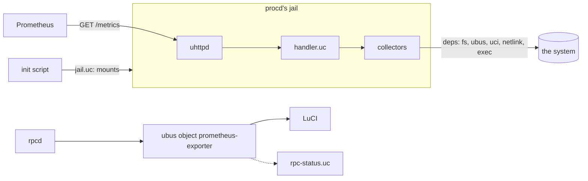

# About the Architecture

The exporter is not a daemon. It is a handler that uhttpd runs, a library of modules, a ubus object that rpcd serves, and an init script that ties them to procd. This page covers how those pieces fit, and why they are cut where they are.

---

## The pieces

- **uhttpd and the handler.** `/usr/libexec/prometheus-exporter/handler.uc` is a uhttpd-mod-ucode handler for `/metrics`. uhttpd is the server every OpenWrt image has. It does TLS, keep-alive and the socket work; the exporter never listens on anything itself.
- **The library.** `/usr/share/ucode/prometheus/exporter/` holds the modules that the handler, the command line, `check` and the ubus object share, `prometheus.exporter.<module>`: the loader, the configuration, the scrape, the exposition format, the jail's rules. In front of them, `/usr/share/ucode/prometheus/exporter.uc` is the collector API, `prometheus.exporter`.
- **The collectors.** One module each, in `/usr/share/ucode/prometheus/collectors/`, installed by the base package or by a package of its own.
- **The ubus object.** rpcd serves `prometheus-exporter` from a ucode plugin. It is how LuCI, or a script, asks the exporter what it would do: which collectors are installed, whether a value is valid, how each collector does.
- **The init script.** It checks the configuration and works out the jail from what the collectors declare. It grants the jail's user what the collectors need (its ubus ACL, capabilities, groups, read access). Then it hands procd the uhttpd instance, which runs as that user, never as root.

## A process per request

uhttpd-mod-ucode runs the handler once, when uhttpd starts, and then answers each request in a process forked from that one. So everything the handler did at load time is already done in every request: the collectors are compiled and validated once, and the configuration's `compress` and basic auth are read once. And nothing a request does is there for the next: its memory goes with its process.

That shapes two choices.

First, loading is the place for anything costly that does not change between scrapes, and a change to what was loaded needs a restart, not a reload. Installing a collector package reloads the service. The init script has procd watch every collector module and config the jail mounts, and procd restarts uhttpd when one changed.

Second, what must outlast a request has to go to disk. Two things must:

- **Basic auth's cache.** Checking a password against its hash costs a scrape a large share of its time on a slow CPU, and a cache in memory would be gone by the next request.
- **The ledger:** how long each collector takes, and its circuit breaker. These order the next scrape and say what its deadline has time for (see [About deadlines and circuit breakers](deadlines-and-breakers.md)).

So each uhttpd instance has a small state directory on tmpfs, the one path its jail mounts read-write, and its files are named after the instance. The handler names its instance when uhttpd loads it, by the pid and start time of that process, which no later process can share, and it removes every other instance's files then. A restart starts without state. That is what a changed password or a changed collector should mean anyway, and it is how a quarantined collector is tried again at once.

Requests run at once, so the state is written under a lock: an exclusive `flock()` of the instance's lock file, which the kernel lets go of however a request ends. Each write is a whole new file renamed over the old one, so a read, which takes no lock, never sees half a file. And a scrape records itself by reading the ledger again under the lock and adding to it, so scrapes that ran at once each count.

## A process of its own {#a-process-of-its-own}

A scrape cannot trust its collectors to return. One may loop forever, wait on a FIFO that nothing writes to, allocate until the memory runs out, or call `exit()`. Within one process there is no stopping that. ucode's VM runs a signal handler at its next instruction, which would do, but uhttpd-mod-ucode's VM handles no signals at all (a handler is never called, and the signal's default action ends the request). And a native call blocked in a system call would not reach the next instruction anyway.

So each scrape forks a child, with ucode's `uloop.task`, from the process that already has the collectors loaded: a fork costs no compiling. The child goes through the scrape's plan itself, forked with it. It runs the collectors one after the other, the fastest first, and leaves out those that the deadline, a breaker or the reply's sample limit keeps out, as the scrape would. The scrape holds a timer on the collector that runs. When the collector's budget ends, or the scrape's deadline comes first, the scrape:

- kills the child, with every process under it (a program the collector started would otherwise run on, its parent gone);
- records the collector as stopped;
- forks another child, which goes on after it.

A child that dies under a collector, out of memory or from a crash, costs that collector alone. Each process of the service has a data limit, so a collector that allocates without end aborts its own child, not the router.

The limit the scrape holds a collector to is the child's word, and the child is where the collectors run. A collector that by mistake writes over the plan the child keeps could have the child give a limit past the deadline, or none, or start collectors the deadline leaves no time for. So the scrape also holds the child to the scrape's deadline, whatever the child says:

- A collector the child runs is stopped at the deadline at the latest.
- A child that runs past the deadline with no collector started is stopped a turn of the timer later, a tenth of a second.

The scrape then forks no other child. It goes through the rest of the plan itself, in its own process, where no collector ran, and leaves out every collector left at the deadline (`SCRAPE_DEADLINE`). The runs the child finished before are served. A child that keeps to its limits never meets this: its collectors end at the deadline at the latest, and it hands back the collectors it leaves out at once.

What the child does crosses back to the scrape through a file. The scrape made the file for the child before forking it, and removed it as soon as it was made. Before each collector, the child writes a line saying that it started, with its limit. After the collector, it writes its run: its samples as the text the reply will hold, never re-encoded. A run and the next collector's line go in one write. The scrape reads the file through a descriptor of its own while the child goes on, at its timer's turns and when the child tells it to. So on a router with two cores, the scrape takes in the runs while the child runs the next collector. It holds its timer on the collector the last line names.

The pipe between them carries only short messages:

- that the child started a collector whose limit is near, which the scrape could be past before its timer's next turn;
- that the child has runs worth taking at once;
- that the child has ended.

They are short enough that the scrape reads them whole: ucode's uloop reads the pipe without blocking, and loses a message that is half there.

A run belongs to the collector it names, never to the one the scrape holds its timer on. Stopping a child takes a few milliseconds, since the processes under it must be found and killed. A collector that ends in those milliseconds, past its limit, has its run and the next collector's start written before the child dies. That collector keeps its run, and the next one, which the child had started, runs again in the child forked after it.

The child keeps a progress file beside the ledger, named by the scrape's process: a line before each collector, with the child it runs in. If the scrape process itself dies, killed from outside, the next scrape finds the file, names the collector that was running, quarantines it, and kills the child it may have left looping.

Loading is guarded the same way. uhttpd loads the collectors once, in the process every scrape is forked from, so a module whose top level never returns would keep uhttpd from ever serving. So each module is first checked in a child, for five seconds at most: its text, and then its exports, as the loader checks them.

Five seconds stop a loop. They do not stop a call that ends the process or writes to it, nor one that does what the child would survive and uhttpd would not. And what a top level does in the child it may do again in uhttpd, where nothing stops it. So a top level only declares. At both loads, while it runs, the functions of ucode that block, end or write to the process, load code or change its signals refuse to run, and the module is left out (see [The top level](../reference/collector-interface.md#the-top-level)).

Only the modules that passed there are loaded for real, all of them as one program, each only when its meta is the one checked. What they share, the collector API and the modules behind it, is then compiled once. A program for each collector would compile it once per collector, and keep each copy's source files open. The loader itself is compiled in that child, and never in uhttpd, which holds what it loads for as long as it runs (see [Performance on small routers](performance.md#loading)).

rpcd must never hang either, since it serves the whole of LuCI. So it asks a helper process to load a module it has not seen before, once per version of the module.

This costs a scrape a fork, a line and a run in the file for each collector, plus the file itself; see [Performance on small routers](performance.md#a-process-per-collector).

When no child can be forked (the system is out of processes or memory), or the file the runs cross by cannot be made, the scrape runs the rest of its collectors in its own process, unguarded, rather than not at all.

## Only one module touches the system

`prometheus.exporter.deps` and its modules, one per capability (`deps/ubus.uc`, `deps/exec.uc`, ...), are the only ones that import `fs`, `ubus`, `uci`, `rtnl`, `nl80211` and `socket`. A collector does not import them. It declares in `meta.needs` the capabilities it wants, and `collect` receives exactly those, in its `deps` argument. All it takes of the exporter's code comes from one module, `prometheus.exporter`, the collector API, and it imports no other: the loader refuses one that does, before loading it. The API is to collectors what the ubus object and the configuration are to scripts: the surface a version promises. Behind it, the core's modules move freely.

This is dependency injection, and it pays three times:

- **Tests.** A test builds `deps` from utest's mocks, fed with what real devices answered, and runs the collector as a scrape would. No collector needs a router to be tested.
- **The jail.** What a collector may reach is written down, so the service can build the jail from it, rather than from a list someone keeps by hand.
- **The narrowing.** `deps` is not the module, but a channel over it that hands out less: `fs` without its writing functions; `uci` as handles on the configs a collector named and nothing else, read-only and of the committed configuration only; `exec` only for the programs listed, and with a deadline. A collector that tries for more has no way to get it.

Taking every native function by name in one module also makes `make lint` meaningful. Loading that module on OpenWrt 25.12's ucode fails if the release lacks a function the exporter uses, at build time and not in a scrape.

## The loader

The loader takes every module of the collectors' directory and:

1. refuses one that is not in strict mode (in strict mode a variable never declared is an error, not a global every later collector sees), or that imports anything but the collector API;
2. loads each in a child process first;
3. loads those that loaded there as one program;
4. validates each one's `meta` and `collect`;
5. leaves out one that does not load in time or is not valid, logging why.

The handler has it do all of that in the child, and keeps what passed there. Should the one program not load, each module is loaded alone, as it was in its child.

Loaded together, the collectors share the API's modules, as they share the child they run in. What the API exports (`Result`, `errors`, `services`, `proc`, `exposition`) are functions and constants, to call and to read. A collector that wrote over one would write over it for the others too, and strict mode does not stop that. So each is a module's namespace, which ucode keeps constant, and so is a Result's prototype: writing over one fails. And what a top level writes to the global scope would stay in uhttpd for every scrape. So the loader puts the global scope back as it was once a top level has run, and leaves out a module that changed it. The exporter guards against mistakes, not against code written to get round it (see [Buggy, not hostile](security.md#buggy-not-hostile)).

What a collector is handed is its own. Each run gets a `deps` made for it, and each capability with it, so a collector that writes over `deps.fs.readfile` changes it for itself alone. A broken subpackage costs its own collector and nothing else. The same loader runs in the handler, the command line, `check`, the jail's script and the ubus object, so all of them agree on what is installed.

While the probe waits for its child, uloop takes SIGTERM and SIGINT, and uhttpd's own loop, which starts after the handler, would never see them. procd's SIGTERM to an instance still loading its collectors, as in an upgrade of several packages, would then leave it serving without them until procd killed it. So each module not yet loaded is reported stopped, and the handler ends, as the signal would have ended it.

A scrape waits for its collectors' child in a loop of uloop's too, and so do `check`, the ubus object's `status` and the command line's scrape. SIGTERM or SIGINT (procd stopping a request, or Ctrl-C at a terminal) ends the wait. The scrape then:

- kills the child, with every process under it;
- keeps the runs that ended, and takes none of the rest for a collector's failure;
- removes its progress file, so that the next scrape blames no collector for it;
- ends, as the signal would have ended it.

## Why the ubus object lives in rpcd

The handler only runs inside a request, and only in the jail. Something has to answer questions about the exporter when nobody scrapes, outside the jail, and to LuCI. That is rpcd, which every image runs, and which already serves LuCI's other objects. Its plugin reads with the exporter's own modules, so it sees what the exporter sees.

One method, `status`, runs a scrape. Collectors call ubus objects, and some of those objects are rpcd's own (`wireguard`, `luci`), which rpcd cannot answer while it waits for the scrape. So `status` runs the scrape in a process of its own and replies when that process is done; rpcd answers other calls meanwhile. That process runs the collectors in the service's own jail, with ujail, as `check` and the command line's scrape do, so all of them find what Prometheus gets. And rpcd kills it, with all it started, if it ever outlives a scrape's time.

## See also

- [About the security model](security.md): what the jail is for.
- [Collector interface](../reference/collector-interface.md): `meta`, `deps` and `out` in detail.
- [The jail](../reference/jail.md): the mounts and the state.
