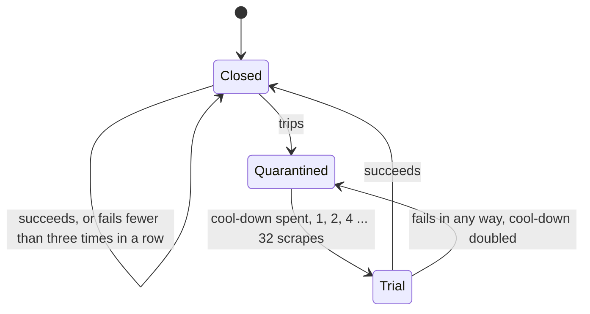

# About Deadlines and Circuit Breakers

A scrape that answers late is worth nothing: Prometheus drops all of it, not only the part that was slow. And a collector that hangs, or fails every time, costs every scrape. This page covers how the exporter keeps a scrape on time, why it sets a misbehaving collector aside for a while, and what that costs.

---

## The problem

Prometheus waits `scrape_timeout`, 10 seconds unless a job says otherwise, and then gives up on the scrape. It does not keep what came in time: `up` is 0, and every series of the target has a gap. On a fast router that never happens. On a 500-MIPS MIPS router, nat_traffic alone takes 8 to 9 seconds on a table of 20,000 connections. One busy evening, and every metric of the router goes dark, its load, its memory and its interfaces with it.

The same is true of a program that hangs. ubnt-manager logging in to a radio that does not answer holds its collector for its whole timeout, 5 seconds, every scrape.

## A deadline per scrape

So each scrape has a deadline. Prometheus says how long it waits, in `X-Prometheus-Scrape-Timeout-Seconds`, and so does vmagent. A scraper that does not say gets the main section's `scrape_timeout`, 10 seconds by default, as is both scrapers' own default. Neither may be more than uhttpd gives the handler, 60 seconds (its `-t`), after which uhttpd kills the request and answers nothing.

The collectors get all of it but half a second. That half second is for the network and the scraper, as blackbox_exporter's own `--timeout-offset` keeps by default. Writing the reply is reckoned apart, because it grows with the samples: 52 ms for 33,000 of them in the devenv (the development container, on a laptop), some thirty times that on a slow router. The exporter measures it per sample as it goes, and keeps back what the samples so far, and the next collector's, will take.

The deadline is checked before each collector, and a collector is started only if what it took before still fits:

- One that does not fit is left out, with `node_scrape_collector_success` 0 and the error `SCRAPE_DEADLINE`.
- One that is running when the deadline comes is stopped there, with the process it runs in (see [About the architecture](architecture.md#a-process-of-its-own)), and fails with `SCRAPE_DEADLINE` too.

The scrape enforces the deadline itself, whatever that process says. The process goes through the plan and tells the scrape each collector's limit, but a collector that went wrong there could make it give a later limit, or none. The scrape stops it at the deadline all the same, and leaves out every collector it had not run.

A program never runs past the deadline. When the whole seconds left before the deadline are fewer than the program's own, it gets those, and it is killed with everything it started when they are spent. The watchdog counts whole seconds, so a program is not started with less than one left.

The scrape logs the collectors it left out in one line, not one each. On a router whose table is always large, that line is the same every scrape, and a line per collector would only repeat it.

## Fastest first

Checking between collectors is only as good as the order they run in. In the order of their names, a slow collector in the middle takes every collector after it down with it. So each uhttpd instance keeps a ledger of how long each collector took, and runs them fastest first. When time runs short, it is the slow one, at the end, that is left out, and the many fast ones are served.

A collector never timed runs after those the ledger knows, since it may be the slow one. Among those never timed, the exporter's own run before those of other packages, and one that declares itself heavy (`meta.cost`) runs after the rest of its kind. The declaration orders and does nothing else. The deadline leaves a collector out only by what the ledger measured, so one that calls itself heavy is still run, and timed. The reply is in the same order whatever the run order: the collectors as the query names them, or by name.

A collector's estimate is a moving average that weighs the last run by 0.25. A collector takes much the same time scrape after scrape, but some things grow or shrink, such as the conntrack table. At 0.25, a one-scrape spike is half gone two scrapes later, and a lasting change is nine tenths there after eight. Before an instance has measured writing a reply, it reckons 50 µs a sample, a 500-MIPS MIPS core's, so a reply is never reckoned shorter than on the slowest router.

## Circuit breakers

A deadline protects one scrape. A collector that hangs, or fails every time, needs more: it should stop costing scrapes at all, for a while. That is a circuit breaker, one per collector.

A breaker trips when the collector:

- has a program killed at its own timeout, since it would be again;
- is still running at the end of its budget, `collector_budget` (5 seconds, half of Prometheus's default timeout) unless its section sets `budget`. It is stopped there, with the process it runs in, and fails with `COLLECTOR_CANCELLED`;
- ends the process it runs in, out of memory, by a crash or by `exit()` (`COLLECTOR_KILLED`), or is running when its scrape process dies;
- fails three scrapes in a row. One failure is often a passing one, a service restarting or a reload; three are 45 seconds of failures at a 15-second interval.

Nothing to observe never counts: it is a success. A collector the deadline left out has neither succeeded nor failed.

A tripped breaker quarantines its collector: it is not run for 1 scrape, then 2, 4, 8, 16, and at most 32. The scrape after that is its trial. A trial that succeeds closes the breaker; one that fails in any way doubles the cool-down. While it is quarantined, the collector answers `node_scrape_collector_success` 0 and `ucode_prometheus_exporter_collector_quarantined` 1. The log has one line when the breaker trips and one when it closes, and nothing between.

The cap is a trade-off. A broken collector costs at most one trial every 32 scrapes, and a trial is bounded by its budget and the scrape's deadline. A fixed one waits at most 32 scrapes to be served again: 8 minutes at Prometheus's usual 15 seconds, 32 at vmagent's minute. A shorter cap would serve fixed collectors sooner and cost more trials; a longer one the reverse.

A collector that runs programs gets a budget of at least its `timeout` and a second more, since the watchdog counts whole seconds. So a budget never quarantines what a timeout allows.

## Counted in scrapes, kept per instance

Cool-downs are counted in the instance's scrapes, not in seconds. A router scraped every minute and one scraped every 10 seconds both try a collector again after the same share of their scrapes. Every scrape of the instance counts, whoever makes it and whatever it selects.

The exporter has no long-lived process of its own to remember anything in. uhttpd answers each request in a process forked from the one that loaded the handler, and that process is gone once it answers. So the ledger, durations and breakers both, is a file in the instance's state directory, on tmpfs, read when a scrape starts and written when it ends. Scrapes can run at once: a scraper, LuCI and someone with curl. Each writes under the state's lock, re-reading the ledger as it is then and adding what it saw, so none is lost and no reader sees half a file.

The ledger is the instance's, and the service's restart starts a new instance without it: every duration and every breaker is forgotten. That is how to try a quarantined collector now, rather than at its trial. A reload that procd does not turn into a restart keeps the ledger.

## Quarantine applies to every scrape

A scrape that names a quarantined collector in `collect[]` does not run it either. The alternative, running whatever is asked for, would let any job that names the collector pay its cost every scrape, and trip and re-trip its breaker. The way to scrape a slow collector is a job of its own, with a longer timeout. With its `budget` raised to match, it is not quarantined in the first place.

While the `exporter` collector, in the base package, is selected, the scrape counts what happened since the service started, by collector: `ucode_prometheus_exporter_quarantines_total`, `_deadline_skips_total`, `_program_timeouts_total` and `_collector_failures_total`. So an alert can ask how often, not only whether now. The counters live in the same ledger, and a restart starts them again at 0, as a new process's counters would.

The scrape writes these counters itself, once its collectors have run, as it writes `node_scrape_collector_*`. The collector does not write them, because the deadline would leave it out first, in the very scrapes the deadline skips count. So they are in every scrape, this one's skips included, whatever the deadline, a breaker or a crash did to the collectors, the exporter collector among them.

`check` and LuCI's status page are different. They run a scrape of their own, in the service's jail, to show what each collector does now, quarantined or not. Beside it, they show what the service's own scrapes found, from the running instance's ledger: each collector quarantined, why, and when it is tried again, and each the deadline left out lately.

## Trade-offs

- **The first scrape after a restart can still be late.** The ledger is empty then. The exporter's own collectors run first, those that declare themselves heavy (nat_traffic, ethtool) after the others, then those of other packages, and a slow one can still take the deadline with the rest. The second scrape knows. Nothing of the ledger survives a restart, by design: a restart is how to forget a quarantine.
- **A collector too slow for the timeout is left out for a while.** The ledger says it does not fit, so it is not run, and not timed. Each scrape that leaves it out makes its estimate three quarters of itself, so that it is tried again, and timed, after a few (3 when it was twice too slow, 9 when ten times). So one slow run costs a few scrapes, not the instance's life. One that is always too slow is tried, and stopped at the deadline, once in a few scrapes. A job with a longer timeout runs it, and keeps its estimate current.
- **Two scrapes at once can each run a trial.** Each sees the cool-down over, and each counts its trial: two that fail double the cool-down twice.
- **A program needs a whole second before the deadline.** A collector whose program would take 10 ms is left out when less than a second is left. Since the fastest run first, the collectors with programs run early, while time is plentiful.

## See also

- [What happens when a collector breaks](when-a-collector-breaks.md): these mechanisms against the Lua exporter's, measured.
- [How to troubleshoot](../how-to/troubleshoot.md#a-collector-is-quarantined)
- [Performance on small routers](performance.md)
- [UCI configuration](../reference/uci-config.md): `scrape_timeout`, `collector_budget` and `budget`.
- [The jail](../reference/jail.md#state): the state directory.
