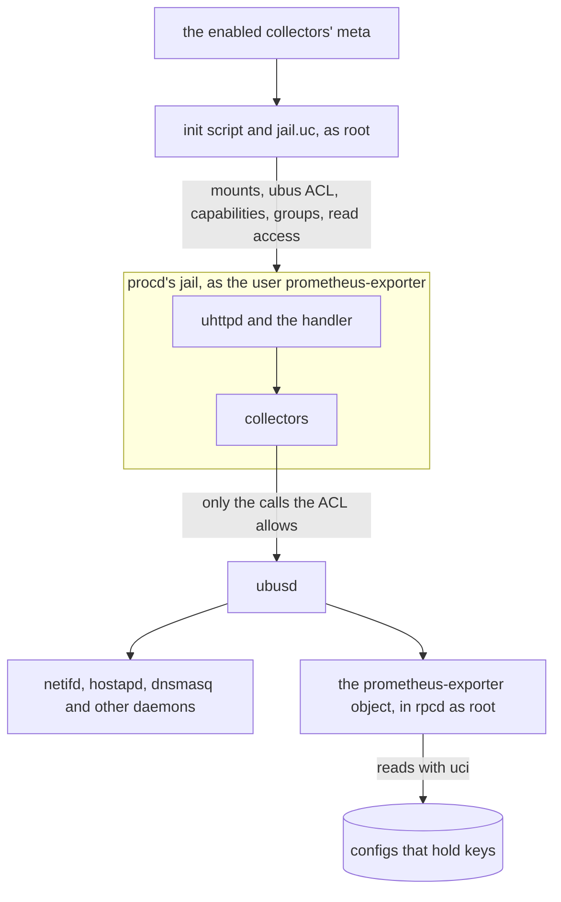

# About the Security Model

The exporter runs on a router, as a user of its own, and answers requests from the network. It reads much of what the router knows: its interfaces and addresses, its clients and leases, its configuration. This page covers what keeps that access to reading, and the trade-offs made along the way.

---

## A jail built from declarations

uhttpd, and the exporter in it, runs in procd's jail. The jail holds:

- the exporter's own code and libraries, procfs, sysfs and the log;
- what the installed and enabled collectors declare: the configs they read, the programs they run, the files and directories they read, and the ubus socket while one of them needs ubus.

Nothing else of `/etc/config` is there, and nothing is writable but the exporter's small state directory.

The jail is computed, not written by hand. Each collector's `meta` says what it needs. The init script asks `jail.uc` what that adds up to, and procd mounts the result. A collector the device does not install, or that its configuration disables, adds nothing. This is what keeps the jail tight: it is exactly as wide as the collectors in use, and it stays right as packages come and go, without anyone keeping a list.

The service's ubus object reads what the jail may not, and hands back only the fields a collector reads (see [Not root](#not-root)).

Some declarations are refused outright:

- a path that is not absolute, or not plain;
- directories that hold what every service has: `/etc/config`, `/run`, `/tmp`, `/usr/lib` and the like.

A collector cannot ask for a socket in `/run`, because the jail would then hold every service's sockets. ujail cannot mount a socket by itself, so a collector names the socket's directory instead, and that directory must be its service's alone, as Unbound's `/var/lib/unbound` is.

A directory the exporter owns, textfile's, is held tighter, because the service makes it as root and mounts it. It must be under `/var`, `/tmp` or `/etc/prometheus-exporter`, and not under `/var/run` or `/tmp/run`, where every service, the exporter included, keeps its sockets and secrets. A value elsewhere is refused before anything is made. This is an allowlist, not the list of shared directories above: whoever may write the exporter's configuration, such as a LuCI login allowed this app alone, cannot have the service make directories in, or mount, the rest of the filesystem.

And `/tmp` is everyone's. On OpenWrt `/var` is a link to it, and any user may make a directory there. A user that starts before the service could make textfile's `/var/prometheus` its own, and feed the exporter metrics. Or it could make it a link to a directory it chose, which root would then make directories under and mount. So the service walks the path from `/` before it makes or mounts it:

- each directory must be root's, and writable by no one else unless it is sticky, as `/tmp` is;
- a link must be root's alone, as `/var` is;
- what is not there, the service makes, root's and 0755, and then checks what it made.

A path that fails is neither made nor mounted, and the service logs why.

That makes `/tmp` safe to allow, and it stays allowed: its directories are on tmpfs, so a script that writes there every minute does not wear the flash. `/var`, which the default is under, is `/tmp`. Another user can still make the directory first, and so keep textfile from reading it until root removes it: a nuisance the service logs, not a way in. For a directory no other user can touch, use one under `/etc/prometheus-exporter`.

The ubus socket matters most of these. ubusd lets root call every object, so a jail running as root with the socket could ask rpcd, netifd or any service for anything they answer. Mounts limit what the exporter can see, not what it can do over ubus. So the jail has the socket only while a collector that needs ubus is enabled, and it does not run as root: ubusd holds it to an ACL of the calls the enabled collectors declare (see [Not root](#not-root)).

The jail has the host's network, not one of its own, because uhttpd must answer on the router's addresses. So a collector that reads a service over TCP, as agh reads AdGuard Home's HTTP API, needs no mount; the capability is what bounds it. `deps.socket.tcp_request` connects only to an address of the device itself. It binds to that address first, so an address that is not the router's fails before anything is sent. A collector's address is an option, set by whoever may write the exporter's configuration, a LuCI login allowed this app alone among them. Bounded this way, it can point the exporter at a port of the router, never at a host of the LAN or beyond. And the collector reads only what answers without a login: agh sends no credentials, since a password the jail's user could read would be a secret in the jail.

The jail is a boundary for the exporter's own mistakes as much as for an attacker's. A collector that parses something wrong cannot write anywhere, and one whose program hangs is killed with everything it started.

Read-only is not the same as harmless, so some files stay out of the jail even when a collector needs part of what they hold. `/etc/config/network` holds WireGuard's private keys, and the wireguard collector does not declare it. To name peers by their descriptions (`peer_names`), it asks the service's ubus object, which reads the config as root and hands over only each peer's public key and description. The keys stay out of the jail's files, and out of every reply the service's user may ask for (see [What the service's user reaches over ubus](#what-the-services-user-reaches-over-ubus)). The ubus object's `interfaces`, by contrast, asks netifd, so that a LuCI user allowed only the exporter's object gets interface names without the file.

## Not root {#not-root}

uhttpd runs in its jail as the user and group `prometheus-exporter`, which the package makes, with no new privileges. Not being root is what gives the rest of the jail its meaning. Root reads every file whatever its mode, may call every ubus object, and has every capability: for root, the jail's mounts would be all that stood between a mistake and the router. As the service's user, the process reads what the files' modes let it, ubusd refuses it what the ACL does not allow, and it has no capability at all unless an enabled collector declares one.

What a collector needs beyond that, it declares, as it declares its mounts:

- its ubus calls;
- its capabilities;
- the groups whose sockets it connects to;
- read access, for the service's group, to the root-only files of `/proc` and the configs it reads.

The service grants these as root, at each start, and only while the collector is enabled. It takes back what no enabled collector declares any more, a disabled or a removed collector's, and gives each file back the group and mode it had. It takes back all of it when the service stops, is disabled or is removed. So the privileges are as wide as the collectors in use, and stay right as collectors come and go, as the mounts do. See [The jail](../reference/jail.md#the-services-user) for each.

This took some choices:

- **The ubus ACL is written for the enabled collectors, not installed for all of them.** An ACL that each package installed would allow its calls as long as the package is there, enabled or not. So the service writes the ACL at each start, for the collectors enabled then, with the options they have, and has ubusd read it again. It writes the ACL in ubusd's ACL directory, outside its run directory, which only root enters, and removes it when it stops. A reboot keeps it, for ubusd to read as it starts: having ubusd read its ACLs again can crash it (see [When ubusd crashes](../reference/jail.md#when-ubusd-crashes)).
- **No call that answers a secret, or reads what its caller names.** ubusd's ACL names objects and methods, never their arguments, so a method is as wide as the widest reply it gives. Some methods a collector would reach for answer more than it reads:
    - rpcd's `file read` reads any file as root, and checks no session for a caller that sends none;
    - its `uci get` reads any config;
    - netifd's `network.wireless status` holds every Wi-Fi network's key;
    - procd's `service list` holds every service's command line and environment.

    The ACL allows none of them. Where a collector needs a little of what they answer, the service's own ubus object, which rpcd runs as root, asks for it and hands over the fields the collector reads, and nothing else. Its methods for the collectors take no arguments, so no caller can point them elsewhere.

- **The object's methods for the collectors never hold rpcd on another daemon.** rpcd serves every object of its plugins in one process, one call at a time, LuCI's and the collectors' `rc list` and `wireguard status` among them. A call that waited on a daemon would hold them all. So `wireless` and `wireguard_peers` ask no daemon. They read the committed wireless and network configs with uci, and the phys in sysfs, in rpcd's own process, and keep only the fields above, by name. An option they do not name, such as a key, a password, a secret or one not there yet, never leaves rpcd. `wireless` keeps its last reply, which holds no more than it answered, to give again while the configs' files and the phys are as they were.

    netifd is not asked. It held the keys in its `network.wireless status`, and it can be busy for seconds while it sets a radio up. What only netifd knew, which interfaces are there and up, the collector asks the kernel itself, over nl80211 and in sysfs, which the jail already had for it (see [ubus object](../reference/ubus.md#for-the-collectors) for how the config's networks are named as netifd names them).

    `time_daemons` must ask procd. The jail has a PID namespace of its own, so its `/proc` lists the jail's processes, not ntpd's or chronyd's. And rpcd's `rc list`, which the jail may call, says whether a service runs by forking each init script's `running`. So `time_daemons` asks procd's `service list` without waiting for the answer, over a connection with a timeout of 3 s, and replies when procd answers; rpcd answers other calls meanwhile. None of these methods runs a program.

- **Capabilities that read, never ones that read past the jail.** A collector may declare `CAP_NET_ADMIN` or `CAP_NET_RAW`. Reading `/proc/net/nf_conntrack`, which is root's alone, would be easiest with `CAP_DAC_READ_SEARCH`. But that capability opens any file of a filesystem the jail has a file of, by its handle, past every mount. And `CAP_DAC_OVERRIDE` would write the jail's procfs. So the service gives that one file to its group instead, as it does the configs.
- **Configs opened to the group, secrets copied.** OpenWrt's configs are mostly root's alone (0600), and a collector reads its configs where uci keeps them. So the service gives the configs the jail mounts to its group, read-only, and takes them back once no enabled collector reads them. `uci commit` gives a config back to root's group, and the reload it triggers gives it to the service's group again. Secrets are handled differently. Basic auth's file is written for the group at each start. The TLS certificate and key are read from copies the service makes at each start and removes when it stops. So `/etc/uhttpd.key` and the hash's config stay root's alone.
- **Root copies a TLS file from where certificates are kept, and nowhere else.** A copy is root reading a file the configuration names, and handing it to the service's group. Whoever may write the configuration, such as a LuCI login allowed this app alone, could otherwise have root copy `/etc/shadow` into the jail, or read `/dev/zero` until the router runs out of memory. So `cert` and `key` are taken only:
    - under `/etc/ssl` (certificates, and OpenWrt's acme's), `/etc/acme` (acme.sh's) and `/etc/prometheus-exporter` (the exporter's own);
    - as `/etc/uhttpd.*` (uhttpd's own, which LuCI serves with).

    Those hold certificates and keys and nothing of the system's, and only root writes them. The rest of `/etc`, which holds the system's secrets, is not allowed. The file must also be a regular file of at most 64 KiB, a chain of certificates' size, and its links, if any, must leave it in those places. A configuration that breaks this is refused with `TLS_PATH` or `TLS_FILE` wherever it is checked: LuCI, `validate`, `check`, start and reload alike. `jail.uc --make` checks again before it reads at most that much, and the init script serves HTTPS only from the copies it made.

- **A capability is the whole process's.** The scrape's child processes are uhttpd's. So while `nft-counters` is enabled, `CAP_NET_ADMIN` is uhttpd's too, and uhttpd is the process that answers requests from the network. What it can change of the network is what that capability allows. A router that does not need nft's counters does not enable the collector.

What stays root's is what must:

- the init script and `jail.uc`, which grant;
- rpcd's ubus object, which writes the hash;
- the `watch` instance, which asks procd for a reload by an event. Otherwise the service's ACL would have to allow that call, for any event.

### What the service's user reaches over ubus {#what-the-services-user-reaches-over-ubus}

These are all the calls the ACL can allow. Each is allowed only while a collector that declares it is enabled (`check` lists the ACL in force). None takes an argument that chooses what is read, and none answers a key, a password or a hash.

| Call | Declared by | What it answers |
| :--- | :--- | :--- |
| `system board` | Every ACL (the canary), `openwrt` | The board's model and OpenWrt's release. |
| `rc list` | `agh`, `bmx7`, `chrony`, `dawn`, `dhcp_leases`, `dnsmasq`, `modemmanager`, `mwan3`, `timesync`, `unbound` | Each init script's start and stop priorities, and whether it is enabled and running. |
| `network.interface dump` | `dhcp_leases`, `openwrt_interfaces` | netifd's status of each logical interface: its addresses, routes, DNS servers and uptime; not its config. |
| `prometheus-exporter wireless` | `wifi`, `hostapd_stations` | Each radio's name, `disabled`, channel, country and HT mode, and each of its networks' interface, SSID or mesh ID, and encryption; not the wireless config, which has the keys. |
| `prometheus-exporter time_daemons` | `timesync` | Whether busybox ntpd and chronyd run: two booleans, not procd's command lines. |
| `prometheus-exporter wireguard_peers` | `wireguard` with `peer_names` | Each WireGuard peer's public key and description, by interface; not the peer sections, which hold the preshared keys. |
| `prometheus-exporter.filesystem mounts` | `filesystem` | Each of the host's mounts with blocks: its device, mount point, type, read-only flag, sizes and inodes. |
| `wireguard status` | `wireguard` | rpcd-mod-wireguard's interfaces and peers: public keys, listen ports, endpoints, allowed IPs, traffic and last handshakes; no private or preshared key. |
| `hostapd.<interface> get_status`, `get_clients` | `hostapd_stations`; `hostapd_ubus_stations` (`get_clients`) | Each access point's SSID, BSSID, channel and airtime, and its stations: MAC addresses, flags, rates, signal and traffic. |
| `dhcp ipv4leases`, `ipv6leases` | `dhcp_leases` | odhcpd's leases: addresses, MAC addresses, DUIDs and host names. |
| `dnsmasq metrics` | `dnsmasq` | dnsmasq's counters. |
| `dawn get_network` | `dawn` | DAWN's access points and clients. |
| `mwan3 status` | `mwan3` | mwan3's interfaces and their tracking. |
| `poe info` | `realtek-poe` | The PoE ports' state and power. |
| `dsl metrics` | `ltq-dsl` | The DSL line's state and counters. |

A collector of another package may declare calls of its own, which the ACL then allows while it is enabled. Installing it is trusting it with them, as with its code (see [Buggy, not hostile](#buggy-not-hostile)). The leases, stations and clients are what a router knows of the people on its network, and they are what those collectors are for. Leave the collectors disabled where their series should not leave the router.

## Buggy, not hostile {#buggy-not-hostile}

Collectors come from packages: the exporter's own, and others that anyone may write. Most of what can go wrong with a collector is a bug:

- a loop whose condition never turns false;
- a read of a FIFO that nothing writes to;
- a table that grows past what anyone expected;
- a family named like another collector's;
- an allocation that never stops.

The exporter is built so that such a collector costs only itself. It runs in a process of its own, is stopped at its budget, is limited in samples and memory, is kept to its own families, and is quarantined when it keeps failing. The [collector contract](../reference/collector-contract.md) lists every rule and what breaking it costs.

What the exporter does not do, and cannot, is contain a hostile collector. A collector is code that a root package installed. It runs in the exporter's own process, as the service's user, with every privilege the enabled collectors were granted, its own or not. Its module is loaded where the handler is. It can call whatever ucode and the modules it imports can, and it could undo any limit set from inside that process. Containing hostile code takes a boundary it cannot reach from where it runs, a user and a kernel sandbox around each collector, and that is a different design with a different cost. Here the boundary is installing the package: a collector package is code you choose to run, installed by root like any other package. What the service's user bounds is what all the collectors together may do.

So the guards are written against mistakes. They hold a collector to what it declared and to what a scrape can afford. They make its failure visible: a reply that says so, a log line, a counter, a quarantine. And they keep the rest of the scrape on time. They do not try to outwit code that means to escape them.

## What collectors get

Inside the jail, a collector gets less than the jail holds. It receives capabilities, not modules:

- the fs functions that read, and none that write;
- uci handles on the configs it named, read-only and of the committed configuration only, so a change staged in uci but not committed is never read;
- programs from its own list only, run without a shell interpreting their arguments, and killed with their children when its seconds are spent.

See [About the architecture](architecture.md#only-one-module-touches-the-system).

And a collector imports one module only, the collector API, so it has no way to the system but those capabilities. A collector that imports `fs`, or calls `require('fs')`, is refused before it is loaded. This too is a rule against mistakes. An author used to ucode scripts imports `fs` without a second thought, and a collector ported from elsewhere reaches for the module it knew. The loader reads the module's text for its imports and those calls, which is what such a collector has. Code written to get round the rule, reaching `require` some other way, would get round it, and would be hostile.

The tests hold our collectors to what they declare in the same spirit. They run each collector in the filesystem its jail gives it, so a read of a path it did not declare fails the test, rather than passing there and finding nothing in the service.

## Basic auth, over TLS only

Basic auth sends the password with every request, encoded but not encrypted. Over HTTP, anyone on the path reads it. So the exporter takes basic auth over HTTPS only. `auth_user` and `auth_password` without `cert` and `key` are an invalid configuration, refused wherever it is checked: start, reload, `check`, the ubus object's `validate` and LuCI alike. A configuration that asks for a login is never served without TLS, not even with a warning.

`auth_password` holds a crypt hash, never the password, so the configuration, its backups and LuCI's forms never hold the secret. The ubus object makes the hash, so the password is not on a command line, where `ps` would show it. Neither the password nor the hash is logged, and no reply of the ubus object holds the hash.

The hash is also kept apart, in `/etc/config/prometheus-exporter-auth`, mode 0600, not in the exporter's config. LuCI's ACL for the app grants reading the exporter's config, which a login that may only look at the settings needs. Were the hash there, that login could read it through rpcd's `uci` object, and guess the password offline at a hash's pace. So the app's ACL grants nothing of the hash's config, to read or to write. LuCI asks the ubus object's `password` whether one is saved, and hands a new password to `set_password`, which hashes it as root, saves the hash and reloads the service.

So the password is changed at once, apart from Save & Apply, as LuCI's own router password is, and the page says so. A change LuCI staged in the login's session could not be seen there, since the session lists only the changes of configs it may read: its Unsaved Changes would leave the hash out, and its Revert would leave it staged. The jail does not mount that config either. The handler reads uhttpd's file instead, a copy the service writes when it starts, which the service's group reads.

### Why the handler checks the password itself

uhttpd has basic auth of its own: a config file of `prefix:user:hash` lines (`-c`), with a realm (`-r`). The init script writes that file, and uhttpd reads it. But OpenWrt 25.12's uhttpd applies it to files and CGI only, not to a handler's prefix, so a request to `/metrics` would reach the handler without a login. uhttpd fixed this in August 2026 (commit 3aa7e1c), after every 25.12 release so far.

So the handler reads the same file when it starts, and checks every request against it before it scrapes, computing the hash in ucode as musl's crypt would. On a uhttpd that does check, the request is checked twice. On one that does not, it is checked once, which is what matters.

The handler fails closed. A file that is there but wrong denies every request. So does a missing file while the configuration sets `auth_user`. If the file goes and procd starts uhttpd again as it was, with no file for the jail to mount, the handler reads the exporter's configuration, which the jail has, and denies every request rather than serve without the login it asks for.

The hash is computed for any user, so a wrong user takes as long as a wrong password.

### The cache, and what it trades

Computing a hash costs real time on a router's CPU: 135 ms for `hash_password`'s 1000 rounds of SHA-512-crypt on a 500-MIPS MIPS core, at every scrape. And uhttpd's process per request keeps nothing in memory. So after it lets a request in, the handler writes the SHA-256 of that request's exact `Authorization` header to its state directory, bound to the user and the hash. A later request with the same header is let in on that digest, compared in constant time. Any other header pays the full check, and a wrong one stays out and leaves the entry as it was. A changed user or password lets nothing in by the old entry, and a restart forgets it.

The digest reveals no more than what is already on the device. It sits beside the hash, as closed: the service's user's alone, in its state directory of mode 0700 on tmpfs, inside a directory only root enters, never on flash or in a backup. Finding a header that gives the digest is guessing the password, as with the hash, only cheaper per guess: one SHA-256 against a thousand rounds and more. That matters only to whoever can read the file: root on the router, or the service itself. Either can also read the password from the next scrape, since uhttpd ends the TLS. A long random password, as a scraper's should be, is out of reach either way.

### Why the rounds are capped

A `$5$` or `$6$` hash may name up to 9,999,999 rounds. A hash of that many would take a 500-MIPS router twenty minutes per scrape, so anyone who can set the configuration could make the exporter burn the router's CPU. So a hash may have at most 2000 rounds, a quarter of a second there. A hash that names none, which means 5000, is refused like any invalid value. See [Performance on small routers](performance.md#basic-auth).

## Defaults that face inward

The exporter listens on loopback until told otherwise, so a fresh install exposes nothing. `listen_interface` takes a logical interface, so the exporter follows that interface's addresses. `*`, every address, is a choice to make deliberately, since it includes the WAN's.

Once the exporter listens on the LAN, the port is meant for the scrapers alone, and the firewall is what keeps it so ([How to listen on the LAN](../how-to/listen-on-lan.md#keep-it-to-the-scrapers)). Every request is a scrape or a password check, and either costs the router CPU. A client that reaches the port without the right credentials still makes the handler check the ones it sends. uhttpd runs 3 requests at once and keeps at most 10 connections. So such a client delays the scrapes, and no more: requests past those wait their turn, and the connection limit bounds how many can wait. See [HTTP endpoint](../reference/http.md#connections).

## Trade-offs

- **The jail is not a sandbox against a hostile collector.** It narrows what the installed collectors can reach, and its user narrows what they can do; it does not vet them. A collector package is code you choose to run: see [Buggy, not hostile](#buggy-not-hostile).
- **The same jail everywhere it can be had.** `check`, the ubus object's `status` and `prometheus-exporter scrape` run the collectors in the service's own jail, with ujail: as its user, with the capabilities the service has, and under the ACL it wrote. So what they find is what Prometheus gets. While the service is stopped, they run without those capabilities and that ACL. Where ujail cannot run (not root, or a kernel or container that refuses it a namespace), they run outside the jail, as root, and say so; the guards are the same. `prometheus-exporter collector check` runs a module not installed yet, outside the jail. chronyd's server statistics are read only when these run outside the jail: reaching them means writing to chronyd's command directory, which the jail does not give.
- **rpcd runs the ubus object unjailed.** It reads the committed configuration and writes nothing but the hash, through `set_password`. It and `hash_password` alone handle a secret, and they log neither the secret nor the hash. The LuCI app's ACL grants the reading methods, and grants `set_password` only to a login that may write.
- **A password changed in LuCI applies at once, without LuCI's rollback.** `set_password` commits the hash and reloads the service when **Change password** is pressed, apart from Save & Apply, which cannot undo it. A scraper that is not given the new password fails until it is. LuCI's own router password is changed the same way.
