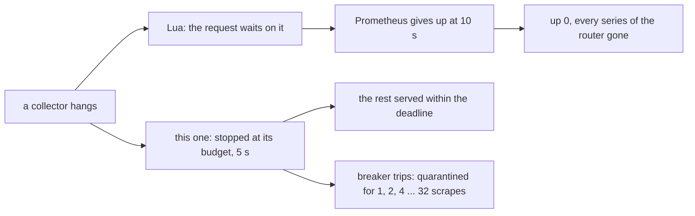

# What Happens When a Collector Breaks

The exporter runs each scrape's collectors in a process of their own. It holds each collector to a budget and the scrape to the scraper's timeout, and it sets aside a collector that keeps failing (see [About deadlines and circuit breakers](deadlines-and-breakers.md)). This page measures what that buys: the same faults, given to this exporter and to the feed's Lua exporter, as a real Prometheus server scrapes them.

---

## The scenarios

Each is a fault a router meets, not one made up for the exporter:

- **A hung ubus daemon.** netifd's `network.wireless`, hostapd's `hostapd.wlan0` and dnsmasq's object are registered, but the daemon behind them sleeps at the first call, and never answers it or any after it: a daemon stuck in a driver's call or a lock. ubusd still lists the objects and hands them each call. Both exporters' wifi, hostapd and dnsmasq collectors call them.
- **A stuck program.** `nft` never exits, as when a large ruleset holds the netlink lock. Both exporters' nft counters collectors run it. Any program a collector runs would do; this is one both exporters run.
- **A label that is not UTF-8.** A static DHCP lease's name is `caf\xe9`, "café" in Latin-1, which `uci` takes as it is. Both exporters' uci_dhcp_host collectors put it in a label.
- **A huge conntrack table on a slow router.** 20,000 connections, as 64 LAN hosts open them to the internet through the router's NAT. The table is on a MIPS 24Kc in QEMU (OpenWrt's malta target), as fast as `make bench-qemu`'s 500-MIPS guest. Both exporters' nat_traffic collectors read the whole table at each scrape.

And one scenario where nothing is wrong, to compare with.

Each exporter has every collector package of its own that installs on the system: for this exporter, the base package and the `-full` group; for the Lua exporter, each of its collector packages that installs no service. Prometheus scrapes them every 15 s with its default `scrape_timeout`, 10 s, eight times a scenario.

## The results

`make failure-demo`, on OpenWrt 25.12.5: this exporter as 0.3.0 has it, before the release, and the feed's prometheus-node-exporter-lua 2026.06.05-r1, scraped by Prometheus 3.15.0. The conntrack scenario ran in QEMU; the others ran in containers on an x86-64 laptop.

| Scenario | Exporter | Scrapes up | Scrape duration | Samples | Prometheus's last error |
| :--- | :--- | :--- | :--- | :--- | :--- |
| nothing wrong | this one | 8 of 8 | 0.06 to 0.07 s | 1191 to 1194 | — |
| nothing wrong | Lua | 8 of 8 | 0.01 to 0.03 s | 897 | — |
| hung ubus daemon | this one | 8 of 8 | 9.50 s, once 5.07 s | 445 (the first two), then 1012 to 1167 | — |
| hung ubus daemon | Lua | 0 of 7 | 10.0 s | 0 | `context deadline exceeded` |
| stuck program | this one | 8 of 8 | 5.07 s (3 scrapes), else 0.05 to 0.06 s | 1192 to 1195 | — |
| stuck program | Lua | 0 of 8 | 10.0 s | 0 | `context deadline exceeded` |
| label not UTF-8 | this one | 8 of 8 | 0.05 to 0.06 s | 1192 to 1195 | — |
| label not UTF-8 | Lua | 0 of 8 | 0.02 to 0.03 s | 888 | `invalid UTF-8 label value: "\"caf\xe9\""` |
| 20,000 connections, QEMU | this one | 8 of 8 | 7.11 s, then 1.43 to 2.13 s, and 6.58 and 6.73 s (nat_traffic tried again) | 820 to 823 | — |
| 20,000 connections, QEMU | Lua | 0 of 7 | 10.0 s | 0 | `context deadline exceeded` |

What each exporter says of itself: the collectors that failed in the last scrape Prometheus got, and the exporter's log. And, at the end, one scrape from the router, with no timeout but uhttpd's own:

| Scenario | Exporter | Failed, last scrape | The log | A scrape without a timeout |
| :--- | :--- | :--- | :--- | :--- |
| nothing wrong | this one | none | nothing | 0.06 s, 1195 samples, 36 collectors |
| nothing wrong | Lua | dawn | dawn's error, every scrape (no dawn daemon) | 0.01 s, 898 samples, 27 collectors |
| hung ubus daemon | this one | dnsmasq, exporter, hostapd_stations, hostapd_ubus_stations, wifi | `COLLECTOR_CANCELLED` and a quarantine for each of the four; `scrape deadline: 28 collectors not served`, then 2 to 6 | 9.50 s, 1014 samples, 36 collectors |
| hung ubus daemon | Lua | — | hostapd_stations' error, 30 s into a scrape | a reply cut off after 30.0 s: 237 samples, 7 of its 27 collectors |
| stuck program | this one | nft-counters | `COMMAND_TIMEOUT (nft: still running after 5 s, killed)`, quarantined for 1, 2, then 4 scrapes | 0.07 s, 1196 samples, 36 collectors |
| stuck program | Lua | — | nothing | a reply cut off after 30.0 s: 651 samples, 16 of 27 collectors |
| label not UTF-8 | this one | uci_dhcp_host | `EXPOSITION_INVALID (in node_openwrt_dhcp_host_info, label 'name': its value is not valid UTF-8)`, quarantined for 1, 2, then 4 scrapes | 0.07 s, 1196 samples, 36 collectors |
| label not UTF-8 | Lua | — | nothing | 0.02 s, 899 samples, 27 collectors: Prometheus refuses it whole |
| 20,000 connections | this one | nat_traffic | `COLLECTOR_CANCELLED (still running after 5.00 s, over its budget of 5 s: stopped)`, quarantined for 1, 2, then 4 scrapes | 2.30 s, 823 samples, 36 collectors |
| 20,000 connections | Lua | — | nothing | 12.7 s, 20806 samples, 27 collectors: complete, and too late |

The QEMU guests ran ucode's loop turn at 7.5 µs with the Lua exporter and 11.3 µs with this one, about 660 and 440 MIPS of a 24Kc. So the Lua exporter had the faster guest.

### What it comes to

A collector that hangs, in each exporter:



**The Lua exporter copes with none of the four, and this one copes with each, at a cost.** The Lua exporter's collectors run one after the other in the request's process, with no time limit of their own. Whatever one waits on, the whole scrape waits on, and Prometheus gives up at 10 s with nothing. The Lua exporter's libubus calls do time out after 30 s, as does uhttpd's wait for output (its `-T`, 30 s), but both are three times Prometheus's timeout. Without a scraper's timeout, the reply ends after 30 s, cut off where the collector stalled, and the collectors after it are missing. A label that is not UTF-8 is written as it is, and Prometheus refuses the whole scrape for it, every time.

**This exporter answers every scrape in time, and serves what it can.** Once the broken collector's breaker has tripped, each scenario costs it that collector alone:

- The stuck program is killed at its timeout, 5 s. The collector fails with `COMMAND_TIMEOUT` and is quarantined for 1, 2, 4 scrapes and up to 32. The scrapes that try it again take 5 s; the others take 0.06 s.
- The label is refused where it is written (`EXPOSITION_INVALID`). The collector's samples are left out, and the rest of the reply is valid.
- On the slow router, nat_traffic is stopped at its budget, 5 s, and quarantined. The first scrape takes 7.1 s, those that try it again 6.6 to 6.7 s, and the others 1.4 to 2.1 s, with every other collector served. The Lua exporter writes the whole table, a series per pair of addresses, 20,806 samples, in 12.7 s: Prometheus has given up by then, at 10.
- A hung ubus daemon costs more, and for longer. Four collectors call it, and each runs until its budget, 5 s, and is stopped (`COLLECTOR_CANCELLED`). The first two scrapes after the start come before the ledger knows any collector's time, so they run those four among the others. One is stopped at its budget, the next at the deadline, and the 28 collectors not yet run are left out (445 samples of 1191). From the third scrape on, the collectors that answer run first, and the scrape loses only the hung ones. But with four of them, each quarantined in turn, one is tried in nearly every scrape. So the scrapes take 9.5 s of Prometheus's 10, as their deadline allows, until the cool-downs grow past the four. At 32 scrapes of cool-down each, that is a trial every 8 scrapes or so.

### What the user sees

| Scenario | This exporter | The Lua exporter |
| :--- | :--- | :--- |
| A hung ubus daemon | `OpenWrtExporterCollectorQuarantined` and `...CollectorFailing` for each collector that calls it, `OpenWrtExporterScrapeSlow` while scrapes take 9.5 s, `OpenWrtExporterDeadlineSkips`; `COLLECTOR_CANCELLED` in the log. The router's other metrics keep coming. | `up` 0: `OpenWrtExporterDown`, with nothing to say which collector, and every series of the router gone. |
| A stuck program | `OpenWrtExporterProgramTimeouts` and `...CollectorQuarantined`; `COMMAND_TIMEOUT` in the log, naming the program. | `up` 0, with nothing to say which collector. |
| A label that is not UTF-8 | `OpenWrtExporterCollectorFailing`; `EXPOSITION_INVALID` in the log, naming the family and the label. | `up` 0, with Prometheus's error naming the value, on the **Targets** page. |
| A huge conntrack table | `OpenWrtExporterCollectorQuarantined` and `...CollectorFailing` for nat_traffic; `COLLECTOR_CANCELLED` in the log. The answer is a job of its own for nat_traffic, with a longer timeout and a `budget` to match, or leaving it out: [Performance on small routers](performance.md#where-it-still-bites-nat_traffic). | `up` 0. |

The alerts are those of [How to monitor a router with the bundled dashboards and alerts](../how-to/dashboards-and-alerts.md#what-each-alert-means). The codes are in [Error codes](../reference/error-codes.md), and the log lines in [Log messages](../reference/log-messages.md). With the Lua exporter, the failure Prometheus sees is the target down. To find which collector failed, scrape it by hand with a longer timeout, one `collect[]` at a time.

## What the numbers do not say

- **The containers are not routers.** Both exporters run as their init scripts start them, uhttpd with the same options, but without procd: with no jail, and as root, so that the containers need no privileges. ubusd, logd and rpcd run; stand-ins answer for netifd, procd and dnsmasq. The QEMU guests boot OpenWrt and run each exporter's service under procd.
- **The Lua exporter's healthy scrape is faster**: 0.02 s where this one takes 0.06 s, on a laptop. This exporter forks a process for its collectors and has 9 more of them; see [Performance on small routers](performance.md).
- **QEMU is not a router either.** Without `-icount`, the guest's clock is the host's, so that Prometheus, outside, measures what the guest takes. The guest's speed is then the host's share of a CPU. That share is set so that a turn of a ucode loop takes about what it takes `make bench-qemu`'s 500-MIPS 24Kc, 9.9 µs, and it is printed with each run. It varies between runs with the host's load.

## How to reproduce it {#reproduce}

```bash
make failure-demo                           # every scenario, some 25 minutes
make failure-demo FD_SCENARIOS="hung-ubus"  # one; healthy, hung-ubus, stuck-nft, bad-utf8, conntrack
```

It builds the packages, and an image with the Lua exporter's packages beside this one's. It runs each scenario's two exporters in containers of their own, unprivileged, on a network of their own, with a Prometheus server (the official image) that scrapes them. The conntrack scenario boots each exporter in QEMU in turn. It needs the network, for the images and for the release's packages for the QEMU guests. It prints the tables above, and keeps them in `bin/failure-demo/`, with each exporter's log and the JSON it read from Prometheus's API. Every container goes when it ends. `FD_SCRAPES` sets the scrapes of each scenario, `FD_CONNTRACK` the table's connections, and `FD_QEMU_CPUS` the share of a CPU the guest gets: see [Make targets](../reference/make-targets.md). The scripts are `devenv/scripts/failure-demo.sh` and `devenv/scripts/failure-demo/`.

## See also

- [About deadlines and circuit breakers](deadlines-and-breakers.md): the mechanisms these numbers measure.
- [About the architecture](architecture.md#a-process-of-its-own): the process the collectors run in.
- [How to troubleshoot](../how-to/troubleshoot.md#a-collector-is-quarantined): a quarantined collector.
