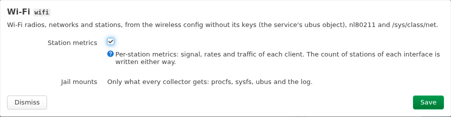

# How to Set a Collector's Options

Some collectors take options of their own, such as wifi's `stations`, dhcp_leases' `leases`, vmstat's `fields`, diskstats' `device_exclude`, textfile's `directory` and unbound's `socket`. [Collectors](../reference/collectors.md) lists each collector's options with their defaults. `service prometheus-exporter check` prints each option with its help and value.

## Set an option

=== "Browser (LuCI)"

    1. Open **Services → Prometheus exporter**, tab **Collectors**.
    2. Press **Edit** on the collector's row, such as **Wi-Fi**. The dialog shows each option by its title, with its help: wifi's `stations` is **Station metrics**.
    3. Change the field, and press **Save**. The values are staged, not applied.

        

    4. Press **Save & Apply** on the page.

=== "Terminal (SSH)"

    A collector's options go in its section of `/etc/config/prometheus-exporter`. The section is named after the collector's module: the collector's name with `_` for `-`.

    ```sh
    uci set prometheus-exporter.wifi=collector
    uci set prometheus-exporter.wifi.stations=0
    uci commit prometheus-exporter
    service prometheus-exporter reload
    ```

    The section's type must be `collector`. If there is no section, or the option is not in it, the collector uses its default.

## Check the value

=== "Browser (LuCI)"

    The Edit dialog checks each value as the exporter would. If the collector does not take a value, **Save** stages nothing, says `Nothing was staged: the exporter would refuse these values.`, and marks the field with why.

=== "Terminal (SSH)"

    ```sh
    service prometheus-exporter check
    ```

    `check` prints a `FAIL` line for a value the collector does not take, such as `collector wifi, section 'wifi': CONFIG_INVALID (stations: expected a boolean, got "maybe")`, and exits 1. The collector fails in every scrape until you fix the value.

## Examples

In LuCI, each example is one field of the collector's Edit dialog, named with the example. Over SSH, run the commands, then `uci commit prometheus-exporter` and `service prometheus-exporter reload`.

Leave out wifi's per-station metrics, which grow with the clients. In LuCI, untick **Station metrics** in **Wi-Fi**'s dialog:

```sh
uci set prometheus-exporter.wifi=collector
uci set prometheus-exporter.wifi.stations=0
```

Have dhcp_leases write a series per lease, with its address, MAC and hostname. In LuCI, tick **Lease series** in **DHCP leases**'s dialog:

```sh
uci set prometheus-exporter.dhcp_leases=collector
uci set prometheus-exporter.dhcp_leases.leases=1
```

Export more of `/proc/vmstat`, by a regular expression of its field names. In LuCI, set **Exported fields** in **Virtual memory statistics**'s dialog:

```sh
uci set prometheus-exporter.vmstat=collector
uci set prometheus-exporter.vmstat.fields='^(oom_kill|pgpg|pswp|pg.*fault|nr_free_pages).*'
```

Watch the partitions of an eMMC or SD card too, which diskstats leaves out by default. This still leaves out flash, loop devices and zram. In LuCI, set **Excluded devices** in **Disk I/O**'s dialog:

```sh
uci set prometheus-exporter.diskstats=collector
uci set prometheus-exporter.diskstats.device_exclude='^(z?ram|loop|mtdblock|ubiblock[0-9]+_)[0-9]+$'
```

`device_exclude` is a POSIX extended regular expression, as ucode compiles it. `^$` leaves out no device.

## In LuCI

The **Browser (LuCI)** tabs above use the collector's **Edit** dialog, on the **Collectors** tab of **Services → Prometheus exporter**. **Save** stages the values, and **Save & Apply** applies them. See [How to use the LuCI app](luci.md).

---

textfile's directory and unbound's socket also change what the jail mounts. For those, see [How to publish metrics from scripts](textfile.md) and [How to monitor Unbound](unbound.md).
