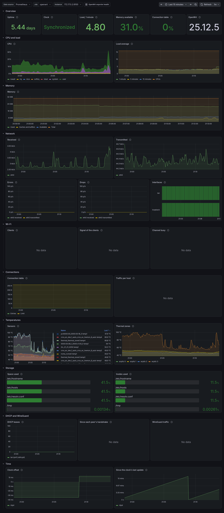
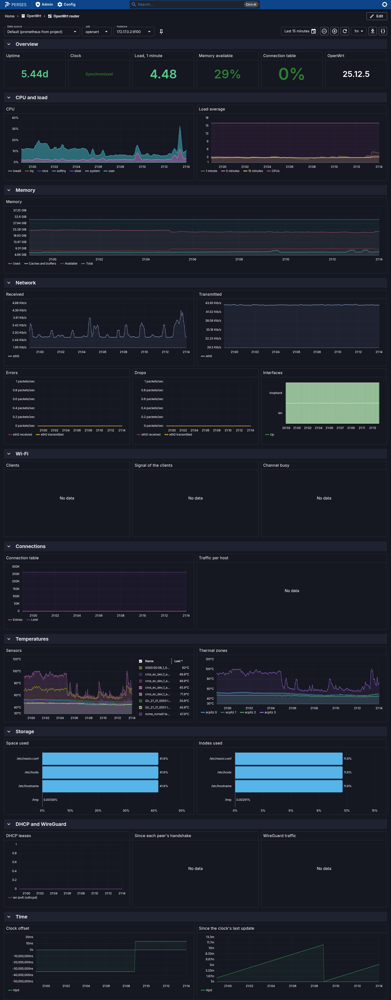
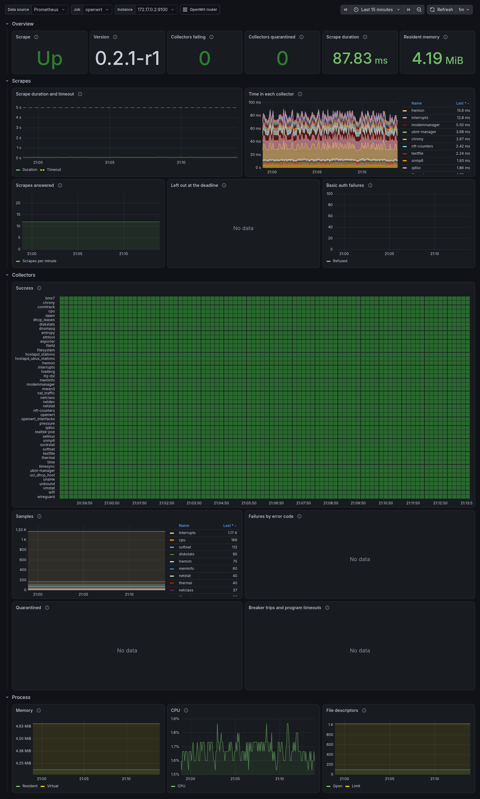
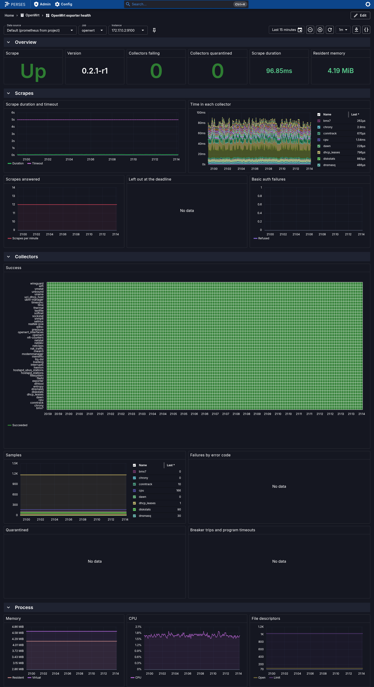

# How to Monitor a Router with the Bundled Dashboards and Alerts

The exporter comes with alerting rules and dashboards, in `monitoring/` of the [repository](https://github.com/m00qek/ucode-prometheus-exporter), or of a release's tarball:

| File | What it is |
| :--- | :--- |
| `monitoring/prometheus/exporter.rules.yml` | Alerts on the exporter's own health: the target down, a collector failing or quarantined, scrapes too slow for their timeout. |
| `monitoring/prometheus/router.rules.yml` | Alerts on a router's basics: the connection table, memory, filesystems, temperatures, the WAN, Wi-Fi radios, the clock, the DHCP pool. |
| `monitoring/prometheus/tests/` | The rules' tests, for `promtool test rules` and `vmalert-tool unittest`. |
| `monitoring/grafana/` | The dashboards **OpenWrt router** and **OpenWrt exporter health**, for Grafana. |
| `monitoring/perses/` | The same two dashboards, for Perses. |

This guide loads them into Prometheus or VictoriaMetrics, Grafana and Perses, and says what each alert means and what to do about it.

## Prerequisites

- A Prometheus, or a VictoriaMetrics with vmagent, that scrapes the router: see [Monitor a router with Prometheus](../tutorials/monitor-a-router.md). The rules and dashboards work for every router the server scrapes, whatever its job is called; only `OpenWrtExporterDown` names the job, `openwrt`.
- The collectors whose panels and alerts you want. A panel whose collector is not installed shows no data, and an alert whose collector is not installed never fires: nothing else breaks. See [Choosing collectors](choose-collectors.md).
- A copy of `monitoring/`.

---

## 1. Load the rules into Prometheus

Copy the rule files where Prometheus reads its config, and name them in `prometheus.yml`:

```yaml
rule_files:
  - /etc/prometheus/rules/openwrt/*.rules.yml

alerting:
  alertmanagers:
    - static_configs:
        - targets: [ 'alertmanager:9093' ]
```

If your scrape job is not called `openwrt`, change `job="openwrt"` in `OpenWrtExporterDown`'s expression to yours: a target that does not answer has no metric of the exporter's to find it by. Then check the files and reload:

```bash
promtool check rules /etc/prometheus/rules/openwrt/*.rules.yml
curl -X POST http://localhost:9090/-/reload    # with --web.enable-lifecycle; or send Prometheus SIGHUP
```

Run Prometheus with `--enable-feature=extra-scrape-metrics`: it then writes `scrape_timeout_seconds`, which `OpenWrtExporterScrapeSlow` and the **Scrape duration and timeout** panel compare the scrape's duration with. Without it, the alert takes the timeout to be 10 seconds, Prometheus's default, and the panel shows the duration alone.

The alerts carry `severity: critical` or `severity: warning`, for Alertmanager's routes.

## 2. Or load them into VictoriaMetrics

vmalert reads the same files, as they are:

```bash
vmalert -rule='/etc/vmalert/openwrt/*.rules.yml' \
    -datasource.url=http://victoriametrics:8428 \
    -remoteWrite.url=http://victoriametrics:8428 \
    -notifier.url=http://alertmanager:9093
```

What differs from Prometheus:

- vmagent writes `scrape_timeout_seconds` for every target, without a flag.
- `OpenWrtExporterCollectorFailing`'s description runs a query (`query`, `sortByLabel`), as both servers' templates can.
- `make monitoring-check` loads the rules with `vmalert -dryRun` and runs their tests with `vmalert-tool unittest` too, so they keep working there.
- The dashboards take VictoriaMetrics as a Prometheus data source, in Grafana and in Perses: MetricsQL runs their PromQL.

## 3. Import the dashboards into Grafana

Each dashboard asks for its data source, its job and its instance in the variables at its top, so either way imports it as it is.

- **By hand:** **Dashboards → New → Import**, upload `monitoring/grafana/openwrt-router.json`, then `exporter-health.json`.
- **Provisioned:** copy the two files into a directory Grafana reads, and add a provider, `/etc/grafana/provisioning/dashboards/openwrt.yaml`:

    ```yaml
    apiVersion: 1
    providers:
      - name: openwrt
        folder: OpenWrt
        type: file
        options:
          path: /var/lib/grafana/dashboards/openwrt
    ```

A link at the top of each dashboard opens the other, with the same router.

## 4. Apply the dashboards to Perses

The dashboards take their data source from a variable that lists the Prometheus data sources of the project, and the global ones: the project needs one, or Perses a global one. Then, with percli logged in to your Perses:

```bash
percli login https://perses.example.net
percli apply -f monitoring/perses/openwrt-router.yaml --project <project>
percli apply -f monitoring/perses/exporter-health.yaml --project <project>
```

`percli lint -f <file> --online` checks a dashboard against your server's plugins first.

## 5. Change a threshold

Each threshold is in its rule's expression, and a comment above the rule says what it means. Edit it there, and in the rule's test in `monitoring/prometheus/tests/`, then run the tests:

```bash
promtool test rules monitoring/prometheus/tests/*.test.yml
```

From a checkout of the repository, `make monitoring-check` runs them with every other check: see [Make targets](../reference/make-targets.md#monitoring).

---

## What each alert means

### The exporter's health

The failures behind these are in [Error codes](../reference/error-codes.md); [Troubleshooting](troubleshoot.md) says how to find them on the router.

| Alert | Severity | Fires when | Do |
| :--- | :--- | :--- | :--- |
| `OpenWrtExporterDown` | critical | `up` has been 0 for 5 minutes: the router or the exporter is down, the scrape timed out, or basic auth refused the scraper. | `service prometheus-exporter status` on the router; Prometheus's **Targets** page says why the scrape failed. See [Prometheus cannot scrape it](troubleshoot.md#prometheus-cannot-scrape-it). |
| `OpenWrtExporterCollectorFailing` | warning | A collector's `node_scrape_collector_success` has been 0 for 15 minutes: it failed, was quarantined or was left out at the deadline in every scrape. The description lists its failures since the service started, by [error code](../reference/error-codes.md). A collector with nothing to observe succeeds, and never fires it. | `service prometheus-exporter check` runs it now and says why it fails. See [A collector fails](troubleshoot.md#a-collector-fails). |
| `OpenWrtExporterCollectorQuarantined` | warning | A collector's circuit breaker tripped in the last 15 minutes: it hung, was killed, ran over its budget, had a program killed at its timeout, or failed three scrapes in a row. It is left out for 1 to 32 scrapes, then tried again. | `check` says what tripped it, and when it is tried again. See [A collector is quarantined](troubleshoot.md#a-collector-is-quarantined) and [About deadlines and circuit breakers](../explanation/deadlines-and-breakers.md#circuit-breakers). |
| `OpenWrtExporterDeadlineSkips` | warning | The scrape deadline left a collector out, or killed its program, in more than 2 scrapes of 30 minutes (`SCRAPE_DEADLINE`). The first scrape after a restart can be late once. | The scrapes need more time than the job's `scrape_timeout`: scrape the slow collector in a job of its own with a longer timeout, or raise the job's. See [Collectors are left out at the deadline](troubleshoot.md#collectors-are-left-out-at-the-deadline). |
| `OpenWrtExporterProgramTimeouts` | warning | A collector's program was killed at its timeout in the last 30 minutes (`COMMAND_TIMEOUT`). | Give it more time, [How to give programs more time](exec-timeout.md), or find why the program hangs: a radio or a daemon that does not answer. |
| `OpenWrtExporterAuthFailures` | warning | Basic auth refused more than 5 requests in 15 minutes. A scraper with the wrong password is `OpenWrtExporterDown` instead. | A script or a scraper with an old password, or someone guessing it: keep the port to the scrapers, [How to listen on the LAN](listen-on-lan.md#keep-it-to-the-scrapers). |
| `OpenWrtExporterScrapeSlow` | warning | Scrapes took more than 80% of the scraper's timeout for 15 minutes. The exporter answers in time by leaving the slowest collectors out, so they are next. | The **Time in each collector** panel of **OpenWrt exporter health** shows which collector takes the time. As for deadline skips. |

### The router

| Alert | Severity | Fires when | Do |
| :--- | :--- | :--- | :--- |
| `OpenWrtConntrackTableNearlyFull` | warning | The connection table has been more than 80% full for 10 minutes. A full table drops new connections. | Raise `net.netfilter.nf_conntrack_max`, or find the host that opens them: nat_traffic's **Traffic per host** panel. |
| `OpenWrtMemoryLow` | warning | Less than 10% of the memory has been available for 10 minutes. | `/tmp` and the log are memory too. Find what grew: `top`, `du -sh /tmp/*`. |
| `OpenWrtFilesystemNearlyFull` | warning | A writable filesystem has had less than 10% of its space available for 15 minutes. Read-only ones, as the squashfs root, are left out. | On the overlay, remove packages or files; on `/tmp`, what fills it. |
| `OpenWrtFilesystemOutOfInodes` | warning | A writable filesystem has had less than 10% of its inodes free for 15 minutes; one that counts none, as jffs2, is left out. | Many small files: a cache or a spool that grows. |
| `OpenWrtTemperatureAboveMax` | warning | A hwmon sensor has read at or above its chip's own maximum for 5 minutes. Some chips throttle there, as mt76's Wi-Fi radios. | Check the airflow, and where the device stands. |
| `OpenWrtTemperatureCritical` | critical | A hwmon sensor has read at or above its chip's critical temperature for a minute: the hardware may shut down. | As above, now. |
| `OpenWrtThermalZoneThrottling` | warning | A thermal zone has been at or above its passive trip point for 5 minutes: the kernel slows the CPU to cool it. | As above. |
| `OpenWrtWanDown` | critical | The logical interface `wan` has been down for 5 minutes. Name yours in the expression: `wan\|wan6`, `wwan`. | `ifstatus wan` on the router; `node_openwrt_interface_errors` counts the errors netifd holds for it. |
| `OpenWrtWifiRadioDown` | warning | A Wi-Fi radio has had no network up for 10 minutes. A radio disabled on purpose has none either: silence it, or leave it out of the expression. | `wifi status` on the router: the radio is disabled, its driver failed, or it waits for a DFS channel check. |
| `OpenWrtClockNotSynchronized` | warning | The NTP daemon has not had the clock synchronized for 30 minutes. | No NTP server answers, or none is set: **System → System → Time Synchronization** in LuCI. |
| `OpenWrtDhcpPoolNearlyExhausted` | warning | An interface has had 135 or more DHCPv4 leases for 15 minutes: 90% of OpenWrt's default pool of 150 addresses. The exporter does not write the pool's size: set 90% of yours in the expression. | Raise the interface's `limit` in `/etc/config/dhcp`, or shorten its `leasetime`. |

---

## The dashboards

### OpenWrt router

A router or an access point: its uptime, clock, load and release at the top; then CPU and load, memory, the network devices' traffic, errors and drops, the logical interfaces, the Wi-Fi clients, their signal and the channels' use, the connection table and the traffic per host, the temperatures, the filesystems' space and inodes, the DHCP leases, the WireGuard peers' handshakes and traffic, and the clock's offset.

=== "Grafana"

    

=== "Perses"

    

The lab, `make lab`, has no Wi-Fi radio, no WireGuard interface and no firewall: those panels show no data, as on a router without those collectors.

### OpenWrt exporter health

The exporter itself: whether its scrapes succeed, its version, how many collectors fail or are quarantined, each scrape's duration against the scraper's timeout and the time in each collector, each collector's success, samples and failures by error code, its circuit breakers and deadline, and the memory, CPU and descriptors of the uhttpd instance that serves the scrapes. The counters come from the `exporter` collector, in the base package, and start again at 0 when the service restarts.

=== "Grafana"

    

=== "Perses"

    

## See also

- [Metrics](../reference/metrics.md): every family the dashboards and alerts use is there, and `make monitoring-check` fails on one that is not.
- [About deadlines and circuit breakers](../explanation/deadlines-and-breakers.md)
- [Pushing metrics from the router](push-metrics.md), where nothing can scrape it.
