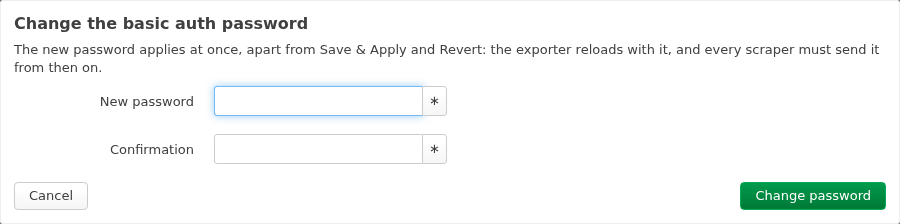

# How to Serve HTTPS with Basic Auth

Make every scrape log in with a user and password, over TLS. The exporter accepts basic auth only over HTTPS. Set the certificate and key along with it, or the service refuses the configuration.

## Prerequisites

- A TLS library for uhttpd: `ls /lib/libustream-ssl.so` finds it. If it is missing, install one, such as `apk add libustream-mbedtls`.
- A certificate and its key, for the name Prometheus uses to reach the device. Each must be a file of at most 64 KiB under `/etc/ssl`, `/etc/acme` or `/etc/prometheus-exporter`, or uhttpd's own `/etc/uhttpd.*`. The service copies no other files (see [About the security model](../explanation/security.md#not-root)). To make a self-signed certificate for `router.lan`:

    ```sh
    mkdir -p /etc/prometheus-exporter
    px5g selfsigned -days 3650 -newkey ec -pkeyopt ec_paramgen_curve:P-256 \
        -keyout /etc/prometheus-exporter/tls.key -out /etc/prometheus-exporter/tls.crt \
        -subj /CN=router.lan -addext subjectAltName=DNS:router.lan
    ```

    uhttpd's own `/etc/uhttpd.crt` and `/etc/uhttpd.key` also work. But they name `OpenWrt` unless uhttpd's config says otherwise, and the certificate is DER. Convert it to PEM for Prometheus (`openssl x509 -inform der -in uhttpd.crt -out openwrt.crt`).

---

## 1. Save the password's hash

Use a long random password: a scraper does not need to remember it. The configuration holds the password's crypt hash, never the password. The hash lives in its own config, `/etc/config/prometheus-exporter-auth`, apart from the rest of the configuration, which LuCI's settings page may read.

Have the exporter hash the password and save the hash there, so the password appears on no command line of the device:

=== "Browser (LuCI)"

    1. Open **Services → Prometheus exporter**, tab **HTTPS & login**.
    2. Fill in **TLS certificate** and **TLS key** with the files of the prerequisites, such as `/etc/prometheus-exporter/tls.crt` and `/etc/prometheus-exporter/tls.key`. **Change password…** needs them.
    3. Press **Change password…**, type the password in **New password** and again in **Confirmation**, and press **Change password**.

        

    The hash is saved at once, separately from **Save & Apply**. See [How to use the LuCI app](luci.md#change-basic-auths-password).

=== "Terminal (SSH)"

    ```sh
    ubus call prometheus-exporter set_password '{"password":"…"}'
    ```

    ```
    {
    	"saved": true
    }
    ```

Or save a hash yourself, over SSH. `prometheus-exporter hash-password` (in the command line's package, `ucode-prometheus-exporter-cli`) reads the password without echoing it, and prints the hash:

```sh
uci set prometheus-exporter-auth.main.auth_password="$(prometheus-exporter hash-password)"
uci commit prometheus-exporter-auth
```

A hash made elsewhere must be one of these:

- `$1$`, as `uhttpd -m <password>` prints
- `$5$` or `$6$` of at most 2000 rounds, as `mkpasswd -m sha-512 -R 1000` makes

`openssl passwd -6` makes hashes of 5000 rounds, which the service refuses. [Performance on small routers](../explanation/performance.md#basic-auth) says why. When you set a hash by hand, put it in single quotes, or the shell reads its `$`.

The service does not accept:

- A DES-crypt hash. Its 13 characters could be a plain password, which uhttpd compares as text when it does not start with `$`.
- bcrypt, which ucode cannot compute in the time of a scrape.

A hash made elsewhere must also write `rounds=` as musl writes it back: without a leading zero, and in range. Otherwise no password matches it.

## 2. Set the user, and HTTPS

=== "Browser (LuCI)"

    1. On the same **HTTPS & login** tab, check that **TLS certificate** and **TLS key** are filled in.
    2. Type the user in **Basic auth user**, such as `prometheus`.
    3. Press **Save & Apply**.

=== "Terminal (SSH)"

    ```sh
    uci set prometheus-exporter.main.auth_user='prometheus'
    uci set prometheus-exporter.main.cert='/etc/prometheus-exporter/tls.crt'
    uci set prometheus-exporter.main.key='/etc/prometheus-exporter/tls.key'
    uci commit prometheus-exporter
    service prometheus-exporter reload
    ```

Basic auth is on while `auth_user` is set. If the service refuses the configuration, LuCI's **Save error** dialog or `logread -e prometheus-exporter` says why. The reasons are:

- a user without a saved hash
- a hash the service does not accept
- no `cert` and `key`
- `cert` or `key` outside those directories (`TLS_PATH`)
- `cert` or `key` not a regular file of at most 64 KiB, or a link out of those directories (`TLS_FILE`)

## 3. Check it

=== "Browser (LuCI)"

    Open **Status → Prometheus exporter**. Under **Service**, **Metrics** gives an `https://` address, and **Basic auth** says **A scrape logs in, over HTTPS**.

=== "Terminal (SSH)"

    ```sh
    service prometheus-exporter status
    ```

    ```
    running
    listening on https://192.168.1.1:9100/metrics, basic auth, gzip when asked, serving 16 collectors
    ```

From the machine that scrapes:

```sh
curl -sk -o /dev/null -w '%{http_code}\n' https://router.lan:9100/metrics
curl -sk -u prometheus:'…' https://router.lan:9100/metrics | head
```

The first command prints `401`. The second prints the scrape.

## 4. Scrape it

In Prometheus, or in vmagent, which takes the same `scrape_configs`:

```yaml
scrape_configs:
  - job_name: openwrt
    scheme: https
    basic_auth:
      username: prometheus
      password_file: /etc/prometheus/openwrt.password
    tls_config:
      ca_file: /etc/prometheus/openwrt.crt   # the router's certificate, self-signed
      server_name: router.lan                # a name the certificate holds
      # insecure_skip_verify: true           # or: no check of the certificate at all
    static_configs:
      - targets: [ 'router.lan:9100' ]
```

Copy the router's certificate (`/etc/prometheus-exporter/tls.crt`), not its key, to the Prometheus host as `ca_file`.

---

## Renew the certificate

The service's jail holds the certificate and key it started with. After you write new ones at the same paths, reload the service. It restarts with the new files:

```sh
service prometheus-exporter reload
```

A tool that renews certificates on its own, such as acme, runs that reload from its hook. Until the reload, the service serves the old certificate. OpenWrt's acme keeps certificates in `/etc/ssl/acme`, and acme.sh's own in `/etc/acme`. `cert` and `key` may point there, and so may their links.

## Turn it off

=== "Browser (LuCI)"

    1. On the **HTTPS & login** tab, empty **Basic auth user**, and press **Save & Apply**.
    2. Press **Remove password**, then **Remove password** in the dialog.

=== "Terminal (SSH)"

    ```sh
    uci delete prometheus-exporter.main.auth_user
    uci commit prometheus-exporter
    ubus call prometheus-exporter set_password '{"password":""}'
    service prometheus-exporter reload
    ```

    The empty password removes the saved hash.

Without a user, a saved hash would go unused anyway.

If `cert` and `key` are still set, the exporter serves HTTPS without a login. To serve HTTP, delete them too.

## See also

- [HTTP endpoint](../reference/http.md#basic-auth): the replies.
- [About the security model](../explanation/security.md): why HTTPS only, and why the handler checks the password itself.
- In LuCI, **Change password…** on the **HTTPS & login** tab hashes the password for you, and saves the hash at once. See [How to use the LuCI app](luci.md#change-basic-auths-password).
