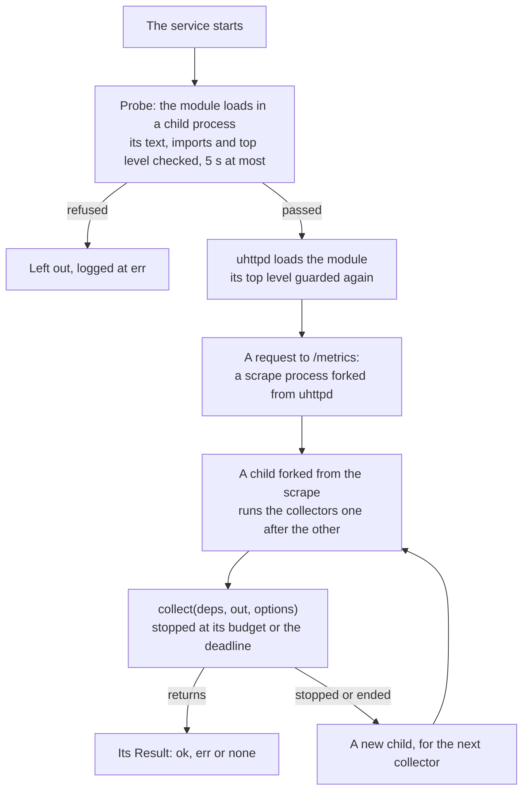

# Collector Contract

This page lists what a collector may do, what the exporter enforces, and what breaking each rule costs. The exporter holds every collector to the same contract, its own and those of other packages. It does so wherever collectors run: in the service's scrapes, in `check`, in the ubus object's `status`, and in the `prometheus-exporter` command.

The contract guards against collectors with bugs, not against hostile ones: see [About the security model](../explanation/security.md#buggy-not-hostile).

---

## What a collector may import

A collector module imports `prometheus.exporter`, the collector API, and nothing else:

```js
import { Result, errors, services, proc, exposition } from 'prometheus.exporter';
```

| Export | Names |
| :--- | :--- |
| `Result` | `ok`, `err`, `none`, `is`, `is_none`, `describe` |
| `errors` | `SOURCE_UNREADABLE`, `SOURCE_INVALID`, `CONFIG_INVALID`, the codes it fails with; `UBUS_CONNECT_FAILED`, `UBUS_CALL_FAILED`, `UBUS_NOT_ALLOWED`, `NL80211_FAILED`, `RTNL_FAILED`, `SOCKET_FAILED`, `COMMAND_NOT_ALLOWED`, `COMMAND_FAILED`, `COMMAND_TIMEOUT`, `PERMISSION_DENIED`, `SCRAPE_DEADLINE`, `EXPOSITION_INVALID`, those its capabilities return |
| `services` | `state`, `idle`, `unless_disabled`, `object_missing`; `ENABLED`, `DISABLED`, `NOT_INSTALLED`, `NOT_FOUND` |
| `proc` | `first_line`, `lines`, `each_line`, `fields`, `rows`, `auxv`; `AT_PAGESZ`, `AT_CLKTCK` |
| `exposition` | `parse`, `format_value`, `sanitize` |
| `u16`, `u32` | functions |

[Collector interface](collector-interface.md#the-collector-api) describes each one. These exports are the collector's semantic-versioning surface: they change incompatibly only in a major version. The modules behind them belong to the core, and may change in any release. See [About versions](../explanation/versions.md#what-a-version-promises).

The loader refuses these before it loads the module:

- **Any other module.**
    - `fs`, `ubus`, `uci`, `socket`, `rtnl`, `nl80211`, `uloop`: the capabilities of `meta.needs` do their work, under the exporter's guards.
    - The core's modules, `prometheus.exporter.<module>`: the API is exactly `prometheus.exporter`, not what is under it.
    - Another collector's module, `prometheus.collectors.<module>`.
    - Pure modules too, such as `math`, `struct` or `digest`. Each would be a dependency the collector's package does not declare, and one more exception to judge. What collectors need of them belongs in the API, in a minor version.
- **Code loaded past the imports.** A call to `require`, `loadfile`, `loadstring` or `include`: `require('fs')` reaches `fs` as surely as an import does.
- **A program started past `exec`.** A call to `system`. What it starts outlives the child process that the scrape kills under the collector, and keeps running. `deps.exec`, instead, kills a program still running at its timeout, with everything it started.

The loader reads the module's text for its imports without compiling it, and skips comments, strings, templates and regular expressions. A collector is a single module. It cannot keep code of its own in another module, because the loader loads every module of the collectors' directory as a collector.

| Where | Broken: |
| :--- | :--- |
| The loader, wherever collectors are loaded: the service, `check`, the ubus object, the command line | Not loaded; logged at `err`: `skipping collector: COLLECTOR_INVALID (<module>: imports fs (line 3): a collector reads files through deps.fs, with 'fs' in meta.needs)` |
| `prometheus-exporter collector check` | A `FAIL` line, with the same text: `FAIL imports fs (line 3): a collector reads files through deps.fs, with 'fs' in meta.needs` |
| The repository's tests | `test/unit/prometheus/imports_test.uc` holds every collector of `src/` to it. |

The message for each refused module names what to use instead:

- for a module of the system, the capability;
- for the core's `result`, `errors`, `services`, `proc` and `exposition`, the API (`take Result from prometheus.exporter`);
- for any other, `a collector imports prometheus.exporter alone`.

## What a collector may touch

| Of the system | Only |
| :--- | :--- |
| Files and directories | Procfs, sysfs, and what `meta.configs` and `meta.paths` declare. The jail has nothing else a collector would read: see [The jail](jail.md). |
| Unix sockets | Those in a directory of `meta.paths`. |
| TCP ports | The device's own, through `deps.socket.tcp_request`. The jail shares the host's network, so they need no declaration. |
| Programs | Those of `meta.commands`. |
| ubus, uci, netlink | Through `deps.ubus` (the calls of `meta.ubus`), `deps.uci` (the configs of `meta.configs`), `deps.rtnl`, `deps.nl80211`. |
| Privileges | As the service's user: the capabilities of `meta.capabilities`, the groups of `meta.groups`, the root-only files of `/proc` in `meta.proc_files`. See [The jail](jail.md#the-services-user). |

Nothing a collector may read is writable.

### In the tests

The devkit's `with_collector` (`prometheus.exporter.devkit.collector`, see [The devkit](devkit.md)) runs a collector's test in the filesystem that the service's jail would give the collector. That filesystem holds the jail's mounts for the collector's `meta`, and what every jail has (`jail.COMMON`): procfs, sysfs, the log's and ubus's sockets, ujail's devices and `/etc/resolv.conf`, the exporter's code, ucode's modules and libraries, the shell, and the exporter's own config and state. Whatever the fs and socket mocks hold, an access outside that filesystem answers as it would in the jail:

| Access | Answers |
| :--- | :--- |
| `readfile`, `open` | `null` |
| `lsdir` | `null`; for a directory above a mount, such as `/etc`, the names of what is mounted under it |
| `stat`, `realpath` | `null`; for a directory above a mount, a directory |
| `glob` | What the pattern matches of the mounts only |
| `open` to write, of any path | `null`: the mounts are read-only |
| `deps.socket.unix_request` | `SOCKET_FAILED`, `connect(): No such file or directory` |
| `deps.socket.tcp_request` | What the mock answers: the jail has the host's network, and the capability itself refuses an address that is not the device's |
| `deps.exec.run` of a program not in `meta.commands` | `COMMAND_NOT_ALLOWED`, as everywhere |
| `deps.ubus.call` of a method `meta.ubus` does not list | `UBUS_NOT_ALLOWED`, as everywhere, as the service's ubus ACL would refuse it |

`with_collector` records each such access. Once the collector has run, it fails the test with `assert.fail()`: a failure, which a property test shrinks. It does not fail from inside the run, where the collector's error boundary would take the failure for a crash, and a collector that falls back on a default would pass.

```
collector 'foo' read /etc/foo/state, which its meta does not declare.
In the service's jail that path does not exist: the read returns null, as it did here.
Declare it in meta.paths (or its directory: '/etc/foo'), or stop reading it.
Declared: /proc, /sys, /etc/config/foo
```

```
collector 'foo' connected to the socket /var/run/foo/foo.sock, which its meta does not declare.
In the service's jail that socket is not there: connect fails with 'No such file or directory', as it did here.
Declare its directory in meta.paths ('/var/run/foo'): the jail cannot mount a socket itself. Or stop connecting to it.
Declared: /proc, /sys
```

```
collector 'foo' ran 'false', which its meta.commands does not list.
The exporter refuses it, in the jail or not: run() returns COMMAND_NOT_ALLOWED without running it, as it did here. A test that expects the collector to fail may pass by accident.
List it in meta.commands, with 'exec' in meta.needs, or stop running it.
Declared commands: true
```

A `meta` the loader refuses, and text that is not valid exposition, fail the test the same way. `with_collector` asserts nothing about the collector's Result: the test does that.

A test's `outside_jail` names paths that a collector looks for even though the jail never has them; the mocks then answer them. An example is chrony's command socket: the chrony collector reads server statistics from it when it runs outside the jail.

## What a collector may do

| A collector may | Through |
| :--- | :--- |
| Read files, sockets, ubus objects, uci configs and netlink | The capabilities of `meta.needs`, in `collect`'s `deps`: see [Collector interface](collector-interface.md#needs). |
| Run programs | `deps.exec`, the programs of `meta.commands` only. |
| Write samples | `out`, the recorder: see [Collector interface](collector-interface.md#out). |
| Log what it could not read | `deps.log`, at `warning`. |
| Take its time | Up to its `budget`, and within the scrape's deadline. |
| Fail | `Result.err(code, details)`: what it wrote is served, and the scrape answers without the rest. |
| Have nothing to observe | `Result.none(reason)`: a success without samples. See [About nothing to observe](../explanation/nothing-to-observe.md). |

## What the exporter enforces

The last column says what a broken rule does to the collector's [circuit breaker](../explanation/deadlines-and-breakers.md#circuit-breakers): it counts as a failure, it trips the breaker at once, or it leaves the breaker unchanged.

| Rule | Limit, by default | Set by | Broken: the error | Its breaker |
| :--- | :--- | :--- | :--- | :--- |
| The module is in strict mode: its first statement is `'use strict'`. | — | — | Not loaded; logged at `err`, `COLLECTOR_INVALID`. | — |
| It imports only the collector API, and calls no `require`, `loadfile`, `loadstring`, `include` or `system`. | — | — | Not loaded; logged at `err`, `COLLECTOR_INVALID`. See [What a collector may import](#what-a-collector-may-import). | — |
| Its top level only declares. At any load, it calls nothing that blocks, ends or writes to the process, loads code, or changes its signals. See [Collector interface](collector-interface.md#the-top-level). | — | — | Not loaded; logged at `err`, `COLLECTOR_IMPURE`. | — |
| Its top level loads in time. | 5 s | — | Not loaded; logged at `err`, `collector '<module>' hung at load`. | — |
| `meta` and `collect` are valid. | — | — | Not loaded; logged at `err`, `COLLECTOR_INVALID`. | — |
| It returns a Result, without throwing. | — | — | `COLLECTOR_NO_RESULT`, `COLLECTOR_CRASHED`. | A failure |
| It returns within its budget. At the budget, the exporter kills its child process, with every process under it. A loop, a system call that never returns, a FIFO opened with no writer: all stop there. | 5 s, or its `timeout` and a second more | `collector_budget`, its section's `budget` | `COLLECTOR_CANCELLED`; none of its samples served. | Trips |
| It is done by the scrape's deadline: the scraper's timeout, less half a second and the time writing the reply takes. | 9.5 s of Prometheus's 10 | the scraper, `scrape_timeout` | `SCRAPE_DEADLINE`: not run, or stopped; none of its samples served. | Unchanged |
| Its programs end in time. The exporter kills one still running, with every process it started. | 5 s, in all, per scrape | `exec_timeout`, `meta.timeout`, its section's `timeout` | `COMMAND_TIMEOUT` | Trips |
| Its ubus calls are answered within its own limit (its budget, or the deadline). | as its budget | — | `UBUS_CALL_FAILED` | A failure |
| It calls over ubus only what `meta.ubus` lists. | — | — | `UBUS_NOT_ALLOWED`, without calling. | A failure |
| The service's user has what the collector declares: its capabilities, read access to its configs and proc files, its socket's group, its ubus calls. | — | the service, when it starts | `PERMISSION_DENIED`, saying what grants it. | A failure |
| It writes at most its samples. The recorder stops it at the next one. | 20,000 | `max_samples`, `meta.max_samples`, its section's `max_samples` | `SAMPLE_LIMIT`, saying how far it got; none of its samples served. | A failure |
| The collectors of a reply write at most its samples in all. The recorder stops the collector that would go past them, and no collector starts once they are written. | 200,000 | `max_scrape_samples` | `SAMPLE_LIMIT`, saying how many were left; none of its samples served. | Unchanged |
| What it writes is what Prometheus accepts: label values and HELP text in UTF-8 and without a NUL byte, family names without one, label names that do not start with `__` and stay distinct once sanitized, and labels that are an object or what `out.labels()` made. The recorder stops it at the first sample that breaks this. | — | — | `EXPOSITION_INVALID`, naming the family and the label; none of its samples served. | A failure |
| A family belongs to one collector: the first, in the reply's order, that writes it. The exporter's own collectors come before those of other packages. | — | — | `FAMILY_CONFLICT`, naming the family's collector; none of its samples served. | A failure |
| It writes none of the exporter's own families, `node_scrape_collector_*` and `ucode_prometheus_exporter_*`, which the scrape writes. | — | — | `FAMILY_CONFLICT` | A failure |
| It takes no more memory than each of the service's processes may. Past that, its own process ends. | A quarter of the RAM, at most 64 MB | `memory_limit`, 0 or 8 MB and more | `COLLECTOR_KILLED`; none of its samples served. | Trips |
| It leaves its process to the exporter: it never ends it, by `exit()` or by a crash of a native module. | — | — | `COLLECTOR_KILLED` | Trips |
| It is not running when its scrape process dies (killed at uhttpd's timeout, or by the kernel out of memory). | — | — | The next scrape reads the dead one's progress file: `COLLECTOR_KILLED`, logged `collector '<name>' was running when a scrape process died`. The child left running is killed. | Trips |
| It reads only what the jail gives it, and runs at the service's priority. | nice 10 | — | What is not mounted is not there: `SOURCE_UNREADABLE`, `COMMAND_FAILED`. See [The jail](jail.md). | A failure |

The collectors run one after the other in a child process forked from the scrape's process, never in the scrape's own. Whatever the child does, the scrape goes on with the next collector, in a new child if the last one was stopped or ended. See [About the architecture](../explanation/architecture.md#a-process-of-its-own).



## What breaking a rule costs

- **The collector, and nothing else.** The scrape answers on time with every other collector: their samples, and `node_scrape_collector_success` 1. The broken one has `node_scrape_collector_success` 0.
- **Its samples.** A collector that was stopped, killed, went over its `max_samples` or wrote another collector's family has none of its samples served. A collector that fails by its own Result keeps what it wrote.
- **A line in the log**, at `warning`: `collector '<name>': <CODE> (<detail>)`. See [Log messages](log-messages.md).
- **A count**, `ucode_prometheus_exporter_collector_failures_total{collector,reason}`, from the `exporter` collector, since the service started.
- **Its breaker.** The exporter quarantines a collector at once when it was stopped at its budget, was killed, or had a program killed at its timeout. A collector that fails in any other way is quarantined after three failed scrapes in a row. A quarantined collector is left out for 1 scrape, then 2, 4 and up to 32: each failed trial doubles the wait, until a trial succeeds. See [About deadlines and circuit breakers](../explanation/deadlines-and-breakers.md#circuit-breakers).

When the deadline leaves a collector out, or stops it, the scrape ran out of time; the collector is not at fault. Its breaker stays as it was.

## What a collector may declare

| `meta` | Effect |
| :--- | :--- |
| `timeout` | The seconds its programs get, 1 to 30, unless its section says otherwise. Its budget is at least that and a second more. |
| `max_samples` | The samples it may write, 1 to 100,000, unless its section says otherwise. For a collector whose samples grow with what it reads, as nat_traffic's grow with the connection table (65,536). |
| `cost: 'heavy'` | Until the ledger has timed it, it runs after the other collectors not yet timed, so the first scrape after a restart does not spend their time on it. It changes only the order. |

Until [the ledger](jail.md#the-ledger) has timed them, as on the first scrape after a restart, the exporter's own collectors run before those of other packages.

## Check a module before installing it

```sh
prometheus-exporter collector check /tmp/my_collector.uc
```

The command:

1. reads the module's text for strict mode, its imports and [its top level](collector-interface.md#the-top-level);
2. loads the module under the load timer and the top level's guard, and validates its `meta`;
3. runs it on the device under the rules above;
4. says how long it took to load and to run, the samples it wrote and its families;
5. checks that its text is valid exposition with each series once, and whether an installed collector or the exporter already writes one of its families.

Each broken rule is a `FAIL` line, and the exit status is `1`. See [The prometheus-exporter command](command.md#collector-check).

## See also

- [Collector interface](collector-interface.md): `meta`, `deps` and `out`.
- [Tutorial: write your first collector](../tutorials/first-collector.md)
- [Error codes](error-codes.md)
