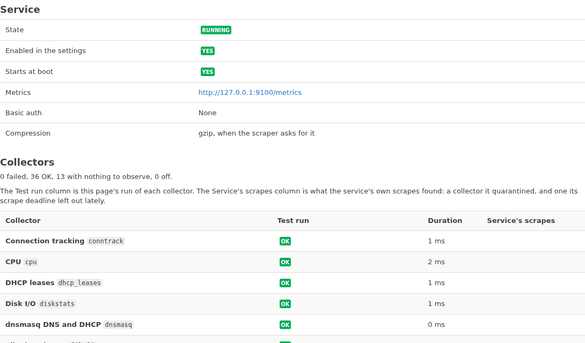

# Monitor a Router with Prometheus

In this tutorial we will install the exporter on an OpenWrt router and look at its metrics on the router itself. Then we will open it to the LAN, and have a Prometheus on our computer scrape it and graph the router's load and traffic. Along the way we will meet the service's `status` and `check` commands, which tell us what the exporter is doing.

It takes about twenty minutes.

## What you need

- A router on OpenWrt 25.12, at `192.168.1.1` on its LAN, with internet access, and a shell on it: `ssh root@192.168.1.1`.
- A computer on the router's LAN, with Docker.

If your router's address is not `192.168.1.1`, use yours wherever it appears.

Where a step can be done in LuCI too, it shows two tabs: **Browser (LuCI)** and **Terminal (SSH)**. Follow either. The LuCI steps need LuCI on the router, at `http://192.168.1.1/`.

---

## 1. Install the exporter

On the router, over SSH, add the exporter's feed and the key that signs its packages:

```sh
feed=https://m00qek.github.io/packages.ucode.dev/25.12
wget -qO /etc/apk/keys/packages.ucode.dev.pem "$feed/feed.pub.pem"
echo "$feed" > /etc/apk/repositories.d/ucode-dev.list
```

Now install the exporter, and its LuCI app. apk fetches their dependencies from that feed and from OpenWrt's own feeds:

=== "Browser (LuCI)"

    1. Open **System → Software** and press **Update lists…**.
    2. Type `prometheus-exporter` in **Filter**.
    3. On the **Available** tab, press **Install…** on the row of `ucode-prometheus-exporter`, then **Install** in the dialog.
    4. Do the same for `luci-app-prometheus-exporter`, then reload the browser page.

=== "Terminal (SSH)"

    ```sh
    apk update
    apk add ucode-prometheus-exporter luci-app-prometheus-exporter
    ```

    apk lists what it installs, and ends with `OK`.

The service starts on its own. Let's ask it how it is doing:

=== "Browser (LuCI)"

    Open **Status → Prometheus exporter**. Under **Service**, **State** says **Running**, and **Metrics** says `http://127.0.0.1:9100/metrics` (reachable from the router only).

    

=== "Terminal (SSH)"

    ```sh
    service prometheus-exporter status
    ```

    ```
    running
    listening on http://127.0.0.1:9100/metrics, gzip when asked, serving 16 collectors
    ```

Notice where it listens: `127.0.0.1`, the router's loopback. For now only the router itself can reach it.

## 2. Look at the metrics

Still on the router, over SSH, ask for a scrape, as Prometheus will:

```sh
wget -qO- http://127.0.0.1:9100/metrics | grep '^node_load'
```

```
node_load1 0.08
node_load5 0.03
node_load15 0
```

These are the router's load averages. Now the last lines of the scrape:

```sh
wget -qO- http://127.0.0.1:9100/metrics | tail -n 4
```

```
node_scrape_collector_observing{collector="vmstat"} 1
# HELP ucode_prometheus_exporter_build_info A metric with a constant '1' value labeled by the version of ucode-prometheus-exporter.
# TYPE ucode_prometheus_exporter_build_info gauge
ucode_prometheus_exporter_build_info{version="0.2.0-r1"} 1
```

Every scrape ends with metrics about the scrape itself: how long each collector took, whether it succeeded, and the exporter's version.

## 3. Open it to the LAN

Our computer is on the LAN, so we make the exporter listen there:

=== "Browser (LuCI)"

    1. Open **Services → Prometheus exporter**, tab **General**.
    2. Pick `lan` in **Listen on**, and press **Save & Apply**.
    3. Open **Status → Prometheus exporter**. **Metrics** now says `http://192.168.1.1:9100/metrics`.

=== "Terminal (SSH)"

    ```sh
    uci set prometheus-exporter.main.listen_interface=lan
    uci commit prometheus-exporter
    service prometheus-exporter reload
    service prometheus-exporter status
    ```

    ```
    running
    listening on http://192.168.1.1:9100/metrics, gzip when asked, serving 16 collectors
    ```

The address is now the router's LAN address. From the computer, check that the exporter answers:

```bash
curl -s http://192.168.1.1:9100/metrics | grep '^node_load1'
```

```
node_load1 0.08
```

## 4. Scrape it with Prometheus

On the computer, make a directory for Prometheus, and in it a file `prometheus.yml`:

```yaml
global:
  scrape_interval: 15s

scrape_configs:
  - job_name: openwrt
    static_configs:
      - targets: [ '192.168.1.1:9100' ]
```

Start Prometheus in Docker, with that file:

```bash
docker run --rm -d --name prometheus -p 9090:9090 \
    -v "$PWD/prometheus.yml:/etc/prometheus/prometheus.yml:ro" prom/prometheus
```

Open `http://localhost:9090/targets`. After a few seconds, the `openwrt` job's target, `http://192.168.1.1:9100/metrics`, shows **UP**. If it shows **DOWN** with `connection refused`, the exporter is still on loopback: go back to step 3.

## 5. Graph the router

Open `http://localhost:9090/query`, type this expression, and press **Execute**:

```promql
node_load1
```

You see one series: the router's one-minute load. Switch to the **Graph** tab to see it over time.

Now the traffic the router receives, in bytes per second, for each network device:

```promql
rate(node_network_receive_bytes_total[1m])
```

You see one series per device, labeled `device`. Give it a few minutes: `rate` needs several scrapes.

Last, ask which version runs there:

```promql
ucode_prometheus_exporter_build_info
```

```
ucode_prometheus_exporter_build_info{instance="192.168.1.1:9100", job="openwrt", version="0.2.0-r1"}  1
```

## 6. Ask the exporter how it is doing

Back on the router, over SSH:

```sh
service prometheus-exporter check
```

The first lines are its findings, something like this:

```
ok   main: HTTP on interface lan, port 9100, keepalive 70s, exec_timeout 5s, scrape_timeout 10s, collector_budget 5s, max_samples 20000, memory_limit 64 MB (a quarter of the RAM, at most 64), gzip when asked
ok   collectors: 16 installed collectors, their options valid
ok   scrape, in the service's jail: 16 of 16 collectors succeeded
```

Then comes one block per collector, with what the collector reads and what the service's jail gives it. Last comes everything the jail mounts. Each `ok` is a check that passed. A problem would show as a `warn` or `FAIL` line that says what is wrong.

In LuCI, **Status → Prometheus exporter** shows the same scrape as a table: one row per collector, each **OK** in **Test run**.

Now let's watch a collector go. Switch off `softnet`, the network softirq statistics:

=== "Browser (LuCI)"

    1. Open **Services → Prometheus exporter**, tab **Collectors**.
    2. Untick **Network softirq statistics** in the **Enabled** column, and press **Save & Apply**.
    3. The tab now says `15 of 16 collectors enabled`.

=== "Terminal (SSH)"

    ```sh
    uci set prometheus-exporter.softnet=collector
    uci set prometheus-exporter.softnet.enabled=0
    uci commit prometheus-exporter
    service prometheus-exporter reload
    service prometheus-exporter status
    ```

    ```
    running
    listening on http://192.168.1.1:9100/metrics, gzip when asked, serving 15 collectors
    ```

It serves one collector fewer. In Prometheus, `node_softnet_processed_total` stops getting new samples. Switch it back on:

=== "Browser (LuCI)"

    Tick **Network softirq statistics** again, and press **Save & Apply**. The tab says `16 of 16 collectors enabled`.

=== "Terminal (SSH)"

    ```sh
    uci delete prometheus-exporter.softnet
    uci commit prometheus-exporter
    service prometheus-exporter reload
    ```

## 7. Clean up

Stop Prometheus on the computer:

```bash
docker stop prometheus
```

The exporter keeps running on the router, listening on the LAN.

---

## What we did

We installed the exporter, read a scrape on the router, opened the exporter to the LAN, had Prometheus scrape it, and graphed the router's load and traffic. We asked the service for its `status` and its `check`, and saw it stop serving one collector and then serve it again.

## Next

- [How to install the exporter](../how-to/install.md), with more collectors: Wi-Fi, WireGuard, the network groups.
- [How to monitor a router with the bundled dashboards and alerts](../how-to/dashboards-and-alerts.md), for a Grafana or Perses dashboard of the router and alerts on it.
- [How to serve HTTPS with basic auth](../how-to/https-basic-auth.md), before the router is scraped from anywhere you do not trust.
- [Metrics](../reference/metrics.md), for every metric there is to graph.
- [About the exporter](../explanation/about.md), for where it comes from.
